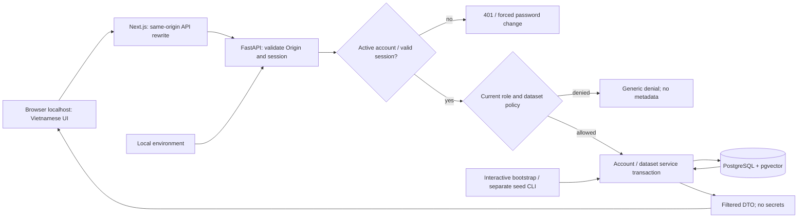

# Phase 1: Local Workspace and Access Control - Research

**Researched:** 2026-10-03
**Domain:** Local Web/API/database, session authentication và dataset authorization
**Confidence:** MEDIUM — tài liệu chính thức và registry đã đối chiếu; chưa chạy ứng dụng hay kiểm tra compatibility toàn stack.

<user_constraints>
## User Constraints (from CONTEXT.md)

Nguồn nội dung sao chép dưới đây: `01-CONTEXT.md`, Implementation Decisions, Implementation Discretion và Deferred Ideas. Đây là quyết định đầu vào, không phải claim nghiên cứu.

### Locked Decisions

<!-- DATA_f83a127b_START -->
### Tài khoản và phiên đăng nhập

- **D-01:** Đăng nhập bằng username + mật khẩu. Không dùng email làm định danh đăng nhập trong MVP.
- **D-02:** Admin đầu tiên được tạo bằng lệnh khởi tạo sau khi chạy Docker Compose; nhập username/mật khẩu lúc chạy. Chạy lại không ghi đè tài khoản hiện có.
- **D-03:** Quên mật khẩu: Admin cấp mật khẩu tạm; người dùng bắt buộc đổi ở lần đăng nhập tiếp theo. Chưa có gửi email khôi phục. Luồng đổi mật khẩu phải khả dụng trước khi cho dùng chức năng nghiệp vụ.
- **D-04:** Phiên hết sau 30 phút không hoạt động, có thời hạn tuyệt đối tối đa 8 giờ. Đăng xuất hoặc vô hiệu hóa tài khoản thu hồi phiên. Cơ chế session cụ thể do researcher/planner lựa chọn; polling tự động không nên được coi là hoạt động người dùng để kéo dài idle timeout.

### Quyền theo dataset

- **D-05:** Dataset là đơn vị cấp quyền MVP, không theo từng file hoặc nhóm phòng ban. Admin cấp/thu hồi dataset cho từng Kỹ thuật viên. Admin quản trị tài khoản/tài liệu/cấu hình và xem toàn bộ báo cáo theo phạm vi đã chốt.
- **D-06:** Kỹ thuật viên mới mặc định không có quyền dataset nào. UI hiển thị hướng dẫn liên hệ Admin khi chưa được cấp quyền.
- **D-07:** Nếu báo cáo dùng dataset A và B nhưng người dùng mất quyền A, chặn toàn bộ nội dung báo cáo/PDF, thông báo quyền đã thay đổi; có thể tạo báo cáo mới chỉ từ B. Đây là policy contract cho phase báo cáo, không thêm triển khai báo cáo vào phase 1. Không để thông báo lộ nội dung/chi tiết dataset bị thu hồi.
- **D-08:** Kỹ thuật viên chỉ tra cứu/phân tích/tạo báo cáo trong dataset được cấp; Admin quản lý upload tài liệu/log, xóa và reindex. Kỹ thuật viên vẫn được nhập/upload ticket để phân tích trong phạm vi quyền ở phase 4; ngoại lệ này không cấp quyền quản lý kho tài liệu chung.
- **D-09:** Carry forward: kiểm tra quyền phía backend trên metadata, truy xuất, nguồn, kết quả/lịch sử và PDF khi các module tương ứng được thêm. Không chỉ ẩn chức năng trong UI. Quyền được kiểm tra lại theo trạng thái hiện tại.

### Giao diện quản trị

- **D-10:** Sidebar bên trái, bảng danh sách và biểu mẫu trong vùng chính. Phase 1 có Tài khoản, Dataset và Cấu hình phù hợp role; chức năng RAG/phân tích/báo cáo được bổ sung đúng phase, không tạo chức năng giả.
- **D-11:** Sau đăng nhập Admin vào Tài khoản; Kỹ thuật viên vào Dataset được cấp. Khi chưa có quyền, hiển thị hướng dẫn liên hệ Admin.
- **D-12:** Giao diện tiếng Việt; giữ thuật ngữ kỹ thuật Dataset, API, WMS/TMS khi phù hợp. Không cần bộ chuyển Việt/Anh trong phase này.
- **D-13:** Tạo tài khoản/chỉnh quyền dataset bằng panel bên phải cạnh bảng; lưu thành công cập nhật bảng. Chi tiết UI như typography, màu, kích thước, validation và responsive do bước UI/planning cụ thể hóa trong bố cục đã chốt.

### Khởi động và dữ liệu demo

- **D-14:** MVP chỉ truy cập localhost trên máy chạy Docker; mặc định không publish cho LAN. Port binding/mạng nội bộ containers phải bảo đảm phạm vi này, không chỉ ghi localhost trong hướng dẫn.
- **D-15:** Có lệnh seed riêng cho tài khoản Kỹ thuật viên và dataset metadata mẫu chưa có tài liệu; thể hiện cả trường hợp có quyền và chưa có quyền. Nhập mật khẩu khi chạy; chạy lại không ghi đè dữ liệu hoặc đổi quyền hiện có. Seed không thay thế lệnh bootstrap Admin.
- **D-16:** Không có OpenAI key vẫn khởi động và sử dụng được phần quản trị. Web hiển thị “Chưa cấu hình AI”; chức năng cần AI ở phase sau yêu cầu key và báo lỗi cấu hình rõ ràng. Phase 1 không cần gọi OpenAI để nghiệm thu.
- **D-17:** Cấu hình lần đầu qua `.env` và hướng dẫn chạy: database/secrets/OpenAI key tại máy chạy Docker. Web chỉ hiển thị trạng thái, không hiển thị giá trị secrets. Không nhập/chỉnh API key qua Web trong phase 1; cấu hình provider qua Web đầy đủ thuộc scope SYS-02 ở phase 3. `.env` thật không được đưa vào Git, chỉ `.env.example` dùng placeholder.

### Implementation Discretion

Người dùng không chọn thư viện auth/UI/queue hay session transport cụ thể; researcher/planner quyết định trong stack đã khóa và các behavior ở trên. Không diễn giải đây là quyền thay đổi thời hạn phiên, role, dataset policy hoặc scope. Username normalization, password policy, bảo vệ Admin cuối cùng và semantics cấp quyền cần được cụ thể hóa trong kế hoạch, không ghi là lựa chọn đã được người dùng trả lời.
<!-- DATA_f83a127b_END -->

### Deferred Ideas (OUT OF SCOPE)

<!-- DATA_13b795ce_START -->
Không phát sinh capability mới trong thảo luận. Các chức năng đã có roadmap tiếp tục thuộc phase tương ứng: ingestion/source management phase 2, RAG và provider config phase 3, ticket upload/analysis phase 4, báo cáo/PDF phase 5. OCR, scheduler, MCP, AI Agent/tools và connectors thật ngoài MVP. Email recovery, song ngữ và LAN access không được chọn cho phase 1.
<!-- DATA_13b795ce_END -->
</user_constraints>

## Summary

Khuyến nghị triển khai một vertical slice thật trước: Compose → migration → bootstrap Admin → login Web → đọc danh sách dataset qua FastAPI và PostgreSQL → logout bị từ chối lần gọi kế tiếp. Sau đó mở rộng account management, forced password change và grants. Đây là đề xuất tổ chức triển khai từ D-01–17 và MVP walking skeleton; không thêm RAG/ingestion/report giả.

Chọn opaque session lưu PostgreSQL, cookie HttpOnly, session/role/grants được đọc theo trạng thái hiện tại trên mỗi request. OWASP hướng dẫn giới hạn idle/absolute phía server và đổi session identifier sau thay đổi quyền xác thực. FastAPI hướng dẫn dùng pwdlib với Argon2 cho password hashing. [CITED: https://cheatsheetseries.owasp.org/cheatsheets/Session_Management_Cheat_Sheet.html] [CITED: https://fastapi.tiangolo.com/tutorial/security/oauth2-jwt/]

**Primary recommendation:** Backend là nguồn chuẩn cho identity/policy; Next.js chỉ UI và proxy cùng origin, PostgreSQL giữ account/session/dataset/grants, migration versioned và seed chỉ insert. Các hợp đồng chi tiết dưới đây là lựa chọn kỹ thuật trong Implementation Discretion, không phải quyết định người dùng đã trả lời.

## Architectural Responsibility Map

Đề xuất phân công theo cấu trúc đã khóa trong context:

| Capability | Primary Tier | Secondary Tier | Rationale |
|---|---|---|---|
| Login, session, forced password change | API / Backend | Database | Server kiểm tra timeout/revocation |
| Account admin, dataset grants | API / Backend | Database | Một transaction bảo vệ invariants |
| Sidebar, tables, right panels, validation feedback | Browser / Client | Frontend Server | UI tiếng Việt gọi API contracts |
| Same-origin API forwarding | Frontend Server | API | Proxy transport, không business policy |
| Persistence/migration/unique constraints | Database / Storage | Backend CLI | Không phụ thuộc lifecycle frontend |
| Local binding, env injection, healthcheck | Local deployment | API/DB | Compose áp dụng D-14/17 |
| Future source/history/report scope | API policy | Future RAG/report modules | Contract, chưa xây các module nghiệp vụ |

## Project Constraints (from AGENTS.md)

Các directives đã đọc từ AGENTS.md trong phiên này, được ghi thành checklist cho planner:

- Dùng Python/FastAPI, LangChain, PostgreSQL/pgvector, OpenAI providers tách riêng, Next.js/TypeScript và Compose; không thay bằng Qdrant/Vite/Agent/OCR/MCP/scheduler.
- FastAPI route gọi services; Next.js không nhân đôi business logic. Giữ cấu trúc backend/app, modules, frontend, data, storage và docs theo project.
- File/dữ liệu local; phase này chỉ localhost; secret server-side, cloud tracing tắt mặc định, không dùng image `latest`, dùng lockfiles/image pins.
- Backend enforcement cho ACL và current permissions; không dựa UI-only. Report metrics tương lai lấy canonical DB records, không top-k.
- Generation chỉ selected evidence; embedding chunk/query cần redaction/input limits ở phase sau. Không làm thao tác trên hệ thống thật.
- Model/provider/package versions cần resolve/lock và kiểm tra trước implementation; baseline docs không chứng minh compatibility toàn stack.
- Mọi thay đổi repo đi qua GSD workflow; artifact này nằm trong `$gsd-plan-phase` được orchestrator giao. Trigger `/graphify` phải gọi skill trước; không có trigger đó trong task này.
- AGENTS.md chưa thiết lập coding convention hoặc project skill riêng. [CITED: AGENTS.md, Project Skills / Conventions]

<phase_requirements>
## Phase Requirements

Các mô tả bên dưới sao chép từ REQUIREMENTS.md; AUTH-03 đã được D-05 xác nhận dataset là đơn vị ACL.

| ID | Description | Research Support |
|---|---|---|
| AUTH-01 | Admin và Kỹ thuật viên có thể đăng nhập bằng tài khoản/mật khẩu và đăng xuất; tài khoản bị vô hiệu hóa không còn truy cập được API. | DB session, expiration boundary, disabled check và revocation tests |
| AUTH-02 | Admin có thể tạo tài khoản, gán role, vô hiệu hóa tài khoản và đặt lại mật khẩu. | Admin endpoints, transactional invariant, forced-change gate |
| AUTH-03 | Admin có thể cấp/thu hồi quyền truy cập dataset cho Kỹ thuật viên; dataset là đơn vị cấp phạm vi MVP được đề xuất. | Per-dataset idempotent grant/revoke, filtered metadata |
| AUTH-04 | Kỹ thuật viên chỉ có thể tìm kiếm, phân tích, xem/tải nguồn và tạo/xem báo cáo trong phạm vi được cấp quyền; backend kiểm tra quyền trên mọi đường dữ liệu, kể cả lịch sử kết quả và PDF. | Shared policy + metadata enforcement now, documented carry-forward contracts; no future report endpoints now |
| AUTH-05 | Admin có thể xem toàn bộ báo cáo; mô hình role/permission cho phép thêm role mà không sửa RAG Core. | Permission map ngoài RAG, future all-dataset report policy unit tests |
| SYS-01 | Người vận hành có thể chạy FastAPI, Next.js/TypeScript, PostgreSQL + pgvector và file storage local bằng Docker Compose; MVP sử dụng OpenAI Embeddings và OpenAI API generation bên ngoài. | Healthcheck/migration/persistence/local binding; no OpenAI required in Phase 1 |
| SYS-04 | Next.js Web dùng FastAPI contracts; pipeline LangChain, parser, Embedding Provider, LLM Provider và các module log_analysis/tickets/reports có boundary rõ theo cấu trúc backend/app đã chốt, cho phép thêm OCR/MCP/scheduler/Agent sau này. | OpenAPI DTO, module/import boundary contracts, deferred provider instantiation |
</phase_requirements>

## Standard Stack

Các tên thư viện được xác nhận từ tài liệu chính thức trong Sources; các số phiên bản là quan sát registry ngày 2026-10-03 qua `pip index versions` / `npm view`, không phải lockfile đã thử. Vì seam verdict SUS, không gắn VERIFIED cho tên package ngoại trừ TypeScript. [CITED: https://nextjs.org/docs/app/getting-started/installation] [CITED: https://fastapi.tiangolo.com/tutorial/testing/]

| Library | Candidate pin | Purpose | Provenance / publish date observed |
|---|---|---|---|
| fastapi [WARNING: flagged as suspicious — verify before using.] | 0.142.2 | API/OpenAPI/Pydantic validation | Official FastAPI; PyPI latest 2026-09-30 |
| uvicorn [WARNING: flagged as suspicious — verify before using.] | 0.54.0 | ASGI process | FastAPI deployment docs; PyPI 2026-09-25 |
| sqlalchemy [WARNING: flagged as suspicious — verify before using.] | **2.0.54 baseline**, registry latest 2.1.3 | Sync ORM transaction | Official 2.0 docs; latest publish 2026-10-02, baseline pin date must record during lock |
| alembic [WARNING: flagged as suspicious — verify before using.] | 1.20.0 | Versioned migrations | Official tutorial; PyPI 2026-09-11 |
| psycopg[binary] [WARNING: flagged as suspicious — verify before using.] | 3.3.6 | PostgreSQL driver | Official install docs; PyPI 2026-09-18 |
| pwdlib[argon2] [WARNING: flagged as suspicious — verify before using.] | 0.3.1 | Password hash/verify | Official FastAPI recommendation; PyPI 2026-08-12 |
| pydantic-settings [WARNING: flagged as suspicious — verify before using.] | 2.15.0 | Env settings/secret values | Official Pydantic docs; PyPI 2026-08-07 |
| next [WARNING: flagged as suspicious — verify before using.] | 16.3.8 | App Router UI and API rewrite | Official Next docs; npm 2026-09-30 |
| react / react-dom [WARNING: flagged as suspicious — verify before using.] | 19.3.0 / 19.3.0 | UI runtime | Official Next install docs; npm 2026-09-09 |
| typescript | 7.0.2 | Type checks | [VERIFIED: npm registry] official typescriptlang.org/download and seam OK; 2026-07-08 |
| pytest / httpx [WARNING: flagged as suspicious — verify before using.] | 9.1.1 / 0.28.1 | Backend integration tests | FastAPI testing docs; PyPI 2026-06-19 / 2024-12-06 |
| @playwright/test [WARNING: flagged as suspicious — verify before using.] | 1.63.0 | Browser/API end-to-end | Official Playwright docs; npm 2026-09-04 |

Use Python 3.12 container baseline and Node 22 LTS candidate; verify actual pinned Next `engines` and Python dependency constraints during lock. Host Python 3.13.7 is an observation, not compatibility evidence for Python 3.12. PostgreSQL 18 + pgvector image candidate `pgvector/pgvector:0.8.7-pg18` derives from official pgvector README; record digest at execution. [CITED: https://github.com/pgvector/pgvector] [CITED: https://nextjs.org/docs/app/getting-started/installation]

### Installation and version validation gate

Đề xuất thực hiện **trong execute**, không chạy trong nghiên cứu: human-verify SUS checkpoint → read exact registry metadata/declared constraints/releases/source repo → resolve in Python 3.12 Linux image and pinned Node image → hash-locked backend requirements and npm package-lock → `pip check`, import smoke, Next production build/typecheck, migrations and browser tests. Lock FastAPI's compatible Pydantic/Starlette/httpx and pwdlib Argon2 transitive dependencies, không tự ép latest transitive. No install command here should be treated as tested. LangChain/provider/parser packages belong to later phases; only define boundaries now.

Future install shape (candidate pins subject to gate):

```text
python -m pip install --require-hashes -r requirements.lock
npm ci
```

### Alternatives Considered

| Instead of | Could Use | Tradeoff / decision |
|---|---|---|
| DB opaque sessions | JWT plus revocation table | JWT still needs current DB checks for D-04/09; choose one DB session path |
| Sync SQLAlchemy + psycopg | Async ORM | Async improves concurrent I/O workloads but adds lifecycle complexity; choose sync routes/dependencies for this small admin slice |
| Next API rewrite | Dedicated reverse proxy | Proxy is viable if actual Set-Cookie/Origin behavior fails browser verification; same-origin policy remains |
| Per-dataset grant mutation | Replace full grant set | Per-item PUT/DELETE avoids one panel overwriting another admin's changes |

Các tradeoffs trên là quyết định thiết kế trong discretion, không claim benchmark.

## Package Legitimacy Audit

Seam chạy cho đúng ecosystems; PyPI packages đều SUS vì `unknown-downloads`, một số thêm `too-new`; không suy diễn đây là malware. npm view postinstall trả rỗng cho năm npm packages được kiểm tra, nghĩa là không quan sát script tại metadata đã đọc; không chứng minh transitive tree an toàn. [CITED: session tools, package-legitimacy check and npm metadata 2026-10-03]

| Packages | Registry | Latest release age | Downloads observed | Source Repo | Verdict | Disposition |
|---|---|---|---|---|---|---|
| fastapi, uvicorn, sqlalchemy, alembic, psycopg | PyPI | 1–22 ngày, latest release | unknown | Official FastAPI/Kludex/SQLAlchemy/psycopg repositories | SUS | checkpoint:human-verify trước install |
| pwdlib, pydantic-settings, pytest, httpx | PyPI | 52 ngày–22 tháng | unknown | Official projects linked by docs | SUS | checkpoint:human-verify trước install |
| next | npm | 3 ngày | 74,675,385/week | vercel/next.js | SUS | checkpoint:human-verify |
| react / react-dom | npm | 24 ngày | 218,142,744 / 205,683,116/week | facebook/react | SUS | checkpoint:human-verify |
| typescript | npm | 87 ngày | 354,808,929/week | microsoft/TypeScript | OK | candidate accepted, compatibility gate still applies |
| @playwright/test | npm | 29 ngày | 82,365,987/week | microsoft/playwright | SUS | checkpoint:human-verify |

**Packages removed due to SLOP:** none observed.
**Packages flagged SUS:** all above except typescript; a consolidated concrete package review checkpoint may list each before installing. Image provenance/digests and all newly introduced direct packages need the same execution-time review. No package was installed during research.

## Architecture Patterns

### System Architecture Diagram

Proposed Phase 1 data flow:



### Component responsibilities / proposed structure

All paths below are **proposed scaffold**, not observed existing runtime paths; context locks parent structure but no creation scripts exist yet.

| Proposed location | Responsibility |
|---|---|
| backend/app/auth | password hashing, session resolver, permissions/policy, CSRF |
| backend/app/database | SQLAlchemy models/session factory, migration integration |
| backend/app/api | DTO/router/dependencies; services own mutations |
| backend/scripts | bootstrap_admin, seed_demo, interactive getpass |
| backend/app/rag, llm, modules | contracts only; no provider client at startup |
| backend/tests | unit policy and real PostgreSQL API integration tests |
| frontend | App Router login/forced-change/shell/accounts/datasets/status; CSS UI tokens |
| docs | local run, security contracts, future ACL checklist |

### Pattern 1: server-side session state

Proposed schema: account UUID, normalized username unique, password hash, role, active flag, must-change-password flag; session token digest unique, account FK, created time, last user activity, absolute expiry, revocation time and CSRF token digest. Use UTC timestamptz, DB constraints and per-request transaction. Store only digest of cryptographically random 32-byte token; cookie value never logged. Cookie proposed name `rag_session`, host-only, Path `/`, HttpOnly, SameSite Strict. For explicitly HTTP localhost use Secure=false; no `__Host-` prefix under HTTP. Reject non-loopback Origin/Host; documented HTTPS deployment later must require Secure=true. OWASP recommends secure cookie attributes and server-side lifecycle. [CITED: https://cheatsheetseries.owasp.org/cheatsheets/Session_Management_Cheat_Sheet.html]

Apply expiry when `now >= last_activity + 30 minutes` OR `now >= created + 8 hours`, before updating activity. Authenticated passive GET/status polling does not update activity. Use CSRF-protected activity endpoint called only for actual navigation/action/key/pointer interaction while document visible; throttle client activity messages. Server cannot cryptographically prove a human interacted: this is an explicit UX mechanism, not anti-bot protection. Logout revokes current session; disable/reset/role change revoke every account session in same transaction; successful password change revokes all sessions, creates a new token/CSRF pair, preserves original absolute deadline. Resolve current account on every request. Deny requests begun after revoke commit; do not claim to recall an already authorized response. These are prescribed semantics implementing D-03/04/09.

### Pattern 2: CSRF / transport

Next rewrites support external URL proxying. Use browser relative `/api/...` → internal backend container. Avoid CORS by design, disable wildcard origins, verify actual Set-Cookie and browser credentials in walking skeleton. [CITED: https://nextjs.org/docs/app/api-reference/config/next-config-js/rewrites]

Choose synchronizer token bound to session, returned by authenticated GET session/CSRF endpoint; send in custom header for every unsafe method. Validate exact configured Origin and JSON Content-Type. Login also validates Origin/custom header and JSON, preventing cross-site form login; reject missing Origin for browser unsafe requests. Session creation rotates token. CSRF and SameSite complement each other; SameSite alone is insufficient. No GET performs mutation, and no auth token/localStorage. [CITED: https://cheatsheetseries.owasp.org/cheatsheets/Cross-Site_Request_Forgery_Prevention_Cheat_Sheet.html]

### Pattern 3: policy independent from RAG

Proposed role codes `admin` and `technician` are NEW schema design values, not in-repo enum findings. Keep role→capability mapping in auth policy; RAG accepts authorized scope and never chooses role. Unknown roles deny by default. `allowed_dataset_ids(principal)` resolves current grants; list metadata uses DB filter before pagination/count. `require_all_datasets(principal, resource_dataset_ids)` implements future A+B whole-resource policy; for technicians require nonempty provenance and subset of current grants, deny missing provenance; admin requires authenticated/active principal and report-read capability. Tests now exercise pure policy with synthetic scopes; no report/PDF endpoint is built. This follows D-05–09 and AUTH-05.

### Pattern 4: transactions / safe administrator invariants

SQLAlchemy Session offers transaction framing; PostgreSQL row locks serialize conflicting updates. [CITED: https://docs.sqlalchemy.org/en/20/orm/session_basics.html] [CITED: https://www.postgresql.org/docs/current/explicit-locking.html]

Prescribe one Session per request, synchronous handlers for synchronous DB work, explicit transaction for each mutation, rollback on failure. Use a singleton administration guard row lock before bootstrap or role/active changes; count active admins inside that same transaction, refuse disabling/demoting last one. Serialize concurrent bootstrap to at most one first Admin; after any Admin exists bootstrap is a no-op with safe message, not a second account factory. Deny self-disable/self-demotion in UI and API; a second Admin can perform those actions if last-admin condition passes. Do not implement account hard delete or dataset delete in this phase.

Username proposal: trim, ASCII lowercase, 3–64 chars, allow letters/digits/dot/underscore/hyphen, immutable username; display name supports Vietnamese Unicode separately. Password proposal: 15–128 Unicode characters (no MFA), allow spaces/paste, no composition rules, no silent truncation/trim; verify current password for self-change. OWASP recommends minimum 15 without MFA and support for long/unicode passwords. [CITED: https://cheatsheetseries.owasp.org/cheatsheets/Authentication_Cheat_Sheet.html]

Use generic login failure and dummy hash verify for unknown usernames; add bounded failed-login delay/DB-backed rate limiter with testable clock and no password logging. Proposed policy: 5 failures/account or source per 5 minutes then 429 with Retry-After, no permanent lock. Local deployment does not replace auth/CSRF. Admin reset accepts temporary secret write-only; mark forced change and revoke old sessions; never include password in subsequent DTO/log. Temporary authenticated sessions access only session/CSRF/password-change/logout, with all business/admin APIs denied. [CITED: https://fastapi.tiangolo.com/tutorial/security/oauth2-jwt/]

### Endpoint contracts (proposed, not existing paths/error enums)

Use versioned API prefix `/api/v1`, JSON DTO and consistent machine code + Vietnamese message. Proposed statuses: 401 invalid/expired session; 403 missing capability/forced change; 404 inaccessible individual dataset (same shape as missing); 409 duplicate username/last-admin conflict; 422 DTO validation; 429 login throttling. Do not leak hidden dataset names/counts. All protected responses `Cache-Control: no-store`; keep private data out of Next shared/static caches.

| Method and proposed route | Contract |
|---|---|
| POST /auth/login | username/password; set session cookie; return safe principal + forced-change flag |
| GET /auth/session | safe principal, expiry and CSRF token; passive, does not extend idle |
| POST /auth/activity | valid session + CSRF; update activity only before expiry |
| POST /auth/logout | revoke current session, expire cookie with matching attributes |
| POST /auth/change-password | current/new password; forced-change allowed; rotate/revoke session |
| GET/POST /admin/users | Admin only, paginated safe DTO / create with temporary password and role |
| PATCH /admin/users/{id} | role/active/display name allowlist; current admin invariant |
| POST /admin/users/{id}/reset-password | write-only temporary password; revoke all sessions |
| GET /datasets; GET /datasets/{id} | current authorized metadata; no records/documents yet |
| POST/PATCH /admin/datasets | create/update metadata only; no upload/source lifecycle |
| GET /admin/users/{id}/datasets | grant panel state, Admin only |
| PUT/DELETE /admin/users/{id}/datasets/{dataset_id} | per-item idempotent grant/revoke; technician target only |
| GET /system/status | authenticated safe status, configured AI boolean only |
| GET /health/live; GET /health/ready | minimal process/DB/migration status; no DSN or secrets |

UI: login → forced-change before shell → Admin accounts / technician datasets. Right panel save awaits API transaction then refreshes table/grants; handle stale session centrally, clear stale rows on 401/403; Vietnamese accessible label/error/loading/empty states and keyboard focus. Configuration page status only, no key textbox. These are applications of D-10–17.

### Bootstrap / seed / Compose patterns

Compose supports service health dependencies and successful one-shot completion. Publish frontend only as loopback; backend/database have no host ports. DB healthcheck → one-shot Alembic migration → API readiness → frontend. Add named DB volume and local upload/storage mounts; don't expose storage as static public directory. Docker documents a historical pre-28 localhost publishing exposure issue: validate engine/version/firewall behavior instead of assuming every localhost mapping is sufficient. [CITED: https://docs.docker.com/compose/how-tos/startup-order/] [CITED: https://docs.docker.com/engine/network/port-publishing/]

Bootstrap/seed use interactive `getpass`, never plaintext CLI args/env example. Bootstrap inserts once; seed separate command creates two technician cases and empty dataset metadata. Initial demo grants only when the associated demo user was newly inserted in this run; rerun never recreates revoked grants or modifies existing roles/passwords/metadata. Unique keys + one transaction; failed seed rolls back. Do not use `ON CONFLICT DO UPDATE` for account/grants. These semantics implement D-02/15.

### Anti-Patterns to Avoid

- Stateless long-lived token with embedded grants; authenticated response caching; polling extending idle indefinitely.
- Frontend-only role checks; unfiltered count/pagination; 403 messages naming hidden datasets.
- Check last-admin count without serialized transaction; startup auto-bootstrap or seed overwriting grants.
- Mandatory OpenAI client initialization/key at startup; adding provider calls to healthchecks.

## Don't Hand-Roll

Prescriptive choices based on official library contracts, not a claim that all policy logic has a ready-made library:

| Problem | Don't Build | Use Instead | Why |
|---|---|---|---|
| Password hashing | own KDF/salt format | pwdlib Argon2 | FastAPI documents supported hash/verify [CITED: https://fastapi.tiangolo.com/tutorial/security/oauth2-jwt/] |
| Schema upgrades | ad-hoc create_all startup | Alembic | versioned DB change management [CITED: https://alembic.sqlalchemy.org/en/latest/tutorial.html] |
| SQL construction | interpolated raw SQL | SQLAlchemy bound expressions | transaction/session abstraction [CITED: https://docs.sqlalchemy.org/en/20/orm/session_basics.html] |
| Env parsing | scattered getenv/type coercion | Pydantic Settings | typed env loading [CITED: https://docs.pydantic.dev/latest/concepts/pydantic_settings/] |
| Browser automation | custom HTTP-only login simulation | Playwright browser test | real browser test runner [CITED: https://playwright.dev/docs/intro] |

## Common Pitfalls

These are implementation hazards inferred from D-01–17 and the selected design; verify each with tests rather than treat them as observed bugs.

1. **Idle boundary revived by requests:** expire before activity update, injectable UTC clock; test at 29:59, exactly 30:00, and 8:00:00; passive polling never touches activity.
2. **Revocation delayed by cached principal:** read account/session/grants per request; two clients prove disable/reset/logout/grant revoke after commit. Include replay of old cookie after restart.
3. **Temporary password unlocks Admin API:** forced-change resolver shared by every protected route; restricted principal allowed only auth helpers/change/logout.
4. **Bootstrap/seed restores revoked demo grants:** repeat seed after removing grants/altering accounts and compare snapshots.
5. **Proxy strips cookie or uses wrong Origin:** verify login/logout/password rotation via Next origin in real browser, not direct FastAPI only.
6. **Two admins remove each other concurrently:** concurrent PostgreSQL integration test and shared guard lock preserve at least one active Admin.
7. **Metadata leak through pagination/errors:** scope query before counts; forbidden dataset returns indistinguishable generic missing response.
8. **Runtime env expected in bundled NEXT_PUBLIC variables:** backend owns secret/config; status DTO boolean only; frontend proxy internal target pinned during image configuration; rebuild if selected Next config embeds target. Validate this behavior at build time.

## Code Examples

Minimal official library pattern; this is illustrative research, not app source. [CITED: https://fastapi.tiangolo.com/tutorial/security/oauth2-jwt/]

```python
from pwdlib import PasswordHash
password_hash = PasswordHash.recommended()
encoded = password_hash.hash(password)
valid = password_hash.verify(candidate, encoded)
```

Proposed policy pseudocode (NEW contract, no claim of existing schema values):

```text
resolve session digest -> active account -> reject expiry/revocation
if password change required and operation not auth-only: deny
resolve current capability and grants
filter dataset query before count/page
for composite resource: require every recorded dataset in allowed scope
```

## State of the Art

| Prior tutorial/example tendency | Selected approach | Evidence / impact |
|---|---|---|
| Copy JWT tutorial wholesale | Extract Argon2 pattern, DB session for immediate revoke | FastAPI tutorial uses JWT; D-04 drives different lifecycle [CITED: https://fastapi.tiangolo.com/tutorial/security/oauth2-jwt/] |
| Treat Compose depends_on as readiness | healthcheck and migration completion dependencies | Official Compose guidance [CITED: https://docs.docker.com/compose/how-tos/startup-order/] |
| Use ASVS 4 category numbers with ASVS 5 | Explicitly use ASVS 5.0.0 numbering | Official versioned ASVS source [CITED: https://github.com/owasp/asvs/tree/v5.0.0/5.0/en] |

No unsupported deprecation claim; full compatibility is deliberately left to execution evidence.

## Assumptions Log

| # | Claim | Section | Risk if Wrong |
|---|---|---|---|
| A1 | [ASSUMED] Candidate pins resolve together on Python 3.12/Linux + pinned Next/React/TS | Standard Stack | Lock/build may require patch selection; test before committing final pins |
| A2 | [ASSUMED] Current target Docker machine can run Linux containers with volumes and loopback bindings | Environment | Docker readiness checkpoint required |

These are unresolved environment/compatibility observations, not locked decisions. Detailed session/schema/endpoints/password policy are prescriptive choices under delegated discretion and do not require re-asking the user to select libraries.

## Open Questions (RESOLVED)

1. RESOLVED — Docker readiness is an execution prerequisite in 01-01-01, checked by read-only Docker/Compose/daemon checks before dependency installation. Missing readiness stops execution with concrete setup instructions; planning can proceed. Docker was not found in this host PATH; no daemon/Compose probe passed, and no universal installation-absence claim is made.
2. RESOLVED — 01-01-01 owns official-source/declared-constraint compatibility resolution, exact dependency locks and image digests; 01-05-01 validates the resulting runtime. Candidate registry versions are observations; this disposition assigns execution work and does not claim compatibility checks passed.
3. RESOLVED — Future AUTH-04/05 source/retrieval/history/report/PDF endpoints are excluded from Phase1 by its approved boundary. 01-04-01 implements shared policy/module contracts and documented endpoint-specific acceptance obligations for later phases; it does not claim future report/source functionality exists.

## Environment Availability

Observed read-only command output this session; no application code or dependency install executed.

| Dependency | Required By | Available | Version observed | Fallback |
|---|---|---|---|---|
| Node/npm | metadata and future frontend | yes | v22.19.0 / 10.9.3 | pinned Node container for execution |
| Python host | registry inspection | yes | 3.13.7 | Python 3.12 Linux container baseline |
| Docker / Compose command | SYS-01 | not found in PATH | `The term 'docker' is not recognized` | no equivalent fallback satisfying locked Compose deployment |
| PostgreSQL/pgvector runtime | integration tests/persistence | not probed, no Docker command | — | Compose after readiness |
| OpenAI key | Phase 1 | intentionally optional | not inspected | safe “Chưa cấu hình AI” status, zero remote calls |
| ctx7 / Context7 tools | documentation lookup | not available in tool inventory/PATH lookup | — | official docs via web tool |

**Missing dependencies with no fallback:** Docker readiness for execution. Documentation research and plan creation remain possible.
**Missing dependencies with fallback:** host Python version differs from selected baseline; use container runtime. No claim made about Python 3.13 package incompatibility.

## Validation Architecture

Nyquist enabled by config. All commands/files/service names below are **proposed scaffolding contracts** for plans; they do not exist/run yet. Use actual PostgreSQL 18 integration DB, never SQLite to prove PostgreSQL locks/ACL/migrations. FastAPI officially documents TestClient/httpx with pytest. [CITED: https://fastapi.tiangolo.com/tutorial/testing/] [CITED: https://docs.pytest.org/en/stable/how-to/fixtures.html]

### Test Framework

| Property | Proposed value |
|---|---|
| Framework | pytest 9.1.1 + httpx 0.28.1; Playwright 1.63.0, candidates subject to package gate |
| Config | backend/pyproject.toml pytest marker/config; frontend/playwright.config.ts; Docker Compose test profile |
| Quick policy | `docker compose run --rm backend-test python -m pytest tests/unit/test_policy.py tests/unit/test_session_clock.py -q` |
| Quick integration | `docker compose run --rm backend-test python -m pytest tests/integration/test_auth.py tests/integration/test_acl.py -q` |
| Full backend | `docker compose run --rm backend-test python -m pytest -q` |
| Full browser | `docker compose run --rm frontend-test npm run test:e2e` |
| Build/type gate | `docker compose run --rm frontend npm run build` and `docker compose run --rm frontend npm run typecheck` |

Use one command per invocation, PowerShell-compatible syntax; service working directory sets backend/frontend paths. Tests execute inside Linux containers; Playwright image exactly matches runner version and has browsers installed during image build. Host fallback after package gate: `python -m pytest backend/tests/unit -q`, `npm --prefix frontend run test:e2e`; DB integration still targets isolated PostgreSQL. Quick subset goal <30 seconds excludes image pull/build/startup and must be measured, not promised.

### Phase Requirements → Test Map

| Req ID | Behavior | Test Type | Proposed automated command | File Exists? |
|---|---|---|---|---|
| AUTH-01 | login/logout/disable/session replay and idle/absolute boundaries | integration + unit | `docker compose run --rm backend-test python -m pytest tests/integration/test_auth.py tests/unit/test_session_clock.py -q` | no — Wave 0 |
| AUTH-02 | Admin CRUD/reset/forced-change/last-admin concurrency | integration | `docker compose run --rm backend-test python -m pytest tests/integration/test_admin_users.py -q` | no — Wave 0 |
| AUTH-03 | default empty/grant/revoke/idempotency/current scope | integration | `docker compose run --rm backend-test python -m pytest tests/integration/test_acl.py -q` | no — Wave 0 |
| AUTH-04 | hidden metadata direct API and composite-resource current-grant contract | integration + unit | `docker compose run --rm backend-test python -m pytest tests/integration/test_acl.py tests/unit/test_policy.py -q` | no — Wave 0 |
| AUTH-05 | role capabilities outside RAG; admin all-resource policy | unit | `docker compose run --rm backend-test python -m pytest tests/unit/test_policy.py -q` | no — Wave 0; future report endpoint deferred |
| SYS-01 | migration/start/restart/persistence/localhost/no-key | integration + smoke | `docker compose run --rm backend-test python -m pytest tests/integration/test_bootstrap_seed.py tests/integration/test_startup.py -q` | no — Wave 0; port exposure also host smoke |
| SYS-04 | OpenAPI DTO/import boundaries and real Web/API/DB flow | contract + e2e | `docker compose run --rm frontend-test npm run test:e2e -- phase1.spec.ts` | no — Wave 0 |

### Fixtures and assertions

Prescribe backend `conftest.py`: isolated test database migrated by Alembic; app factory/dependency overrides; transaction fixture; injectable fixed UTC clock; Admin A/Admin B, granted/ungranted technicians, disabled account, forced-change account; dataset A/B and grants; login helpers retaining cookies/CSRF. No seeded production DB cleanup. Parallel concurrency tests use independent DB connections and synchronization barrier, not a shared fixture transaction. Mock/no-op outbound transport that fails tests if any external AI request occurs; test missing OpenAI key throughout.

Browser `phase1.spec.ts`: real UI login, right panel create/update, two browser contexts for grant/revoke and disabled account, forced-password screen, passive polling + controlled clock backend, cookie attributes/replay/rotation, 403 state clearing, Vietnamese empty/error states, configuration no secrets, seed rerun snapshots. API tests include missing/wrong CSRF, cross-site/missing Origin, wrong Content-Type, unknown username timing path, duplicate normalization, temporary password writes never returned. Future policy tests include A+B after revoke A and missing provenance; no report mock UI.

Host smoke needs `docker compose config` port/volume inspection, database extension/migration head, restart persistence and loopback sockets. Compose readyness alone is not proof of LAN isolation; inspect engine version/actual listening interfaces and test from a second machine if available. Manual visual acceptance covers sidebar/right panel/responsive focus; security and authorization remain automated.

### Sampling Rate

- Per task commit: relevant unit/integration subset above.
- Per wave merge: full backend and browser suite against isolated Compose test DB.
- Phase gate: production frontend build/typecheck, full tests, migration from empty DB/repeat no-op, seed/bootstrap replay, restart persistence and binding smoke green before verify-work.

### Wave 0 Gaps

- All proposed test files/config/fixtures and test services need scaffolding.
- Docker readiness and package human-review checkpoint before install/image build.
- Lock/reproducible images and test-only outbound-deny transport.
- Walking skeleton browser Set-Cookie/CSRF/proxy test before expanding admin features.

## Security Domain

Security enforcement defaults enabled (config contains no explicit false). ASVS 5.0.0 has changed category numbers from the template's ASVS 4 labels; use the actual official 5.0.0 categories below, without claiming certification. [CITED: https://github.com/owasp/asvs/tree/v5.0.0/5.0/en]

### Applicable ASVS Categories

| ASVS 5 category | Applies | Prescribed control |
|---|---|---|
| V6 Authentication | yes | Argon2, generic failure, forced change, rate limit, interactive bootstrap |
| V7 Session Management | yes | server-side timeout, opaque token, revocation, rotation, no polling refresh |
| V8 Authorization | yes | capability map/current grants, deny default, dataset scope before query |
| V2 Validation and Business Logic | yes | DTO allowlists/limits, unique usernames, transaction last-admin invariant |
| V3 Web Frontend Security | yes | CSRF + Origin, safe rendering, no token localStorage/shared cache |
| V4 API and Web Service | yes | backend enforcement, versioned schema, content-type/error contracts |
| V11 Cryptography | yes | pwdlib KDF; standard-library CSPRNG and SHA-256 token digest; no custom crypto |
| V12 Secure Communication | scoped exception | HTTP loopback-only selected MVP; require TLS if deployment expands |
| V13 Configuration / V14 Data Protection | yes | secret env only, restricted bind, filtered status, no secret logging |
| V16 Security Logging and Error Handling | yes | safe audit events for role/grant/reset/disable; no passwords/tokens |

### Known Threat Patterns for this stack

Recommended mitigations derived from OWASP session/CSRF/authentication guidance and project scope:

| Pattern | STRIDE | Standard Mitigation |
|---|---|---|
| Cookie theft/fixation | Spoofing | HttpOnly/host-only, rotate session, server revoke |
| Cross-site admin mutation | Tampering | synchronizer CSRF, exact Origin, JSON/custom header |
| Direct-object metadata leak | Information disclosure | current grants, filtered query/count, generic missing response |
| Admin race removes last administrator | Denial of service | shared guard lock + transaction count check |
| Mass assignment role/escalation | Elevation of privilege | typed DTO allowlist, server capability check |
| Password/reset secret in logs | Information disclosure | write-only DTO, redacted audit, no CLI password args |

## Sources

### Primary official sources (claim confidence MEDIUM via seam)

- FastAPI: https://fastapi.tiangolo.com/tutorial/security/oauth2-jwt/ — pwdlib Argon2 and dummy hash pattern; https://fastapi.tiangolo.com/tutorial/testing/ — pytest/httpx TestClient.
- OWASP: https://cheatsheetseries.owasp.org/cheatsheets/Session_Management_Cheat_Sheet.html — session lifecycle; https://cheatsheetseries.owasp.org/cheatsheets/Cross-Site_Request_Forgery_Prevention_Cheat_Sheet.html — synchronizer/Origin; https://cheatsheetseries.owasp.org/cheatsheets/Authentication_Cheat_Sheet.html — password controls.
- SQLAlchemy: https://docs.sqlalchemy.org/en/20/orm/session_basics.html; Alembic: https://alembic.sqlalchemy.org/en/latest/tutorial.html; psycopg: https://www.psycopg.org/psycopg3/docs/basic/install.html.
- Pydantic Settings: https://docs.pydantic.dev/latest/concepts/pydantic_settings/.
- Next: https://nextjs.org/docs/app/getting-started/installation; https://nextjs.org/docs/app/api-reference/config/next-config-js/rewrites. TypeScript: https://www.typescriptlang.org/download/.
- Docker: https://docs.docker.com/compose/how-tos/startup-order/; https://docs.docker.com/engine/network/port-publishing/.
- PostgreSQL: https://www.postgresql.org/docs/current/explicit-locking.html; pgvector: https://github.com/pgvector/pgvector.
- Testing: https://docs.pytest.org/en/stable/how-to/fixtures.html; https://playwright.dev/docs/intro.
- ASVS versioned source: https://github.com/owasp/asvs/tree/v5.0.0/5.0/en.

### Tool observations / provenance limits

- `query research-plan` suggested Context7; tools unavailable and ctx7 PATH lookup returned no command, so used official web pages as fallback. Digests cached for three research questions.
- `query classify-confidence --provider websearch --verified` returned MEDIUM; do not upgrade web citations to HIGH. `webfetch` classification returned LOW even with verified flag; primary-page factual statements retain CITED, with MEDIUM cross-checked websearch tier and local tool observations distinguished.
- Registry/seam outputs are current observations, not trusted full-stack compatibility. PyPI/npm commands read metadata only; no downloads/install/app execution/OpenAI calls.
- No project graph/test implementation files surfaced in discovery; do not infer runtime state from missing source. Greenfield phase, so Runtime State Inventory omitted.

## Metadata

**Confidence breakdown:**
- Standard stack: MEDIUM — official package names and current registry versions, SUS gates and transitive pins unresolved.
- Architecture: MEDIUM — concrete recommendation satisfies locked behaviors; real proxy/browser/DB behavior still needs walking skeleton.
- Pitfalls: MEDIUM — threat-derived verification cases, not observed implementation bugs.

**Research date:** 2026-10-03
**Valid until:** 2026-10-10 for package pins/security version review; locked context remains authoritative.
**Commit:** delegated to orchestrator; this agent does not commit.
