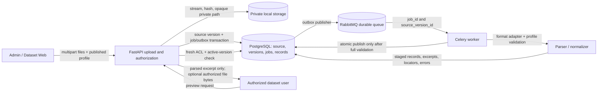

# Phase 2: Dataset Ingestion and Source Lifecycle - Research

**Researched:** 2026-10-07  
**Domain:** Nạp dữ liệu nhiều định dạng, parser provenance, source versioning và durable background jobs  
**Confidence:** MEDIUM

<user_constraints>
## User Constraints (from CONTEXT.md)

### Locked Decisions

DATA_B6D29A10_START
### Upload và version nguồn
- **D-01:** Upload nhiều file có kết quả riêng theo từng file. Trong cùng dataset, nội dung có cùng checksum là no-op idempotent; nội dung thay đổi dưới cùng tên file tạo source version bất biến mới. Reprocess chạy lại trên cùng version, không tạo version mới.
- **D-02:** Version đang active tiếp tục được dùng trong khi version mới được parse/kiểm tra. Chỉ chuyển active khi toàn bộ bước bắt buộc của version mới thành công; lỗi giữ nguyên version active cũ. Cùng một batch có thể có kết quả thành công/thất bại riêng theo file, nhưng không được kích hoạt một phần của một version.

### Schema và lỗi import
- **D-03:** Admin chọn source profile đã công bố trước import (ví dụ: tài liệu chung, log, ticket, incident hoặc bảng vận hành); giao diện cho xem profile, trường kỳ vọng và preview trước khi xác nhận. Chọn profile xác định cách diễn giải dữ liệu nghiệp vụ; không âm thầm đoán schema từ extension/header.
- **D-04:** Parser validation xác định và trả vị trí lỗi theo row/record cùng lý do. Lỗi trường bắt buộc hoặc cấu trúc làm version mới thất bại nguyên tử và không active; dữ liệu hợp lệ có thể được đếm để chẩn đoán nhưng không được xuất hiện như nguồn hoàn chỉnh/ready. Cảnh báo về trường tùy chọn có thể hiển thị mà không chặn khi schema cho phép. Quy tắc bắt buộc/tùy chọn phải được công bố theo profile.
- **D-05:** Schema chuẩn hóa phải giữ ID, hệ thống, trạng thái/ưu tiên, timestamp và locator theo DATA-06. Parser trả nội dung chuẩn cùng provenance, độc lập LLM/provider. Không xóa dữ liệu gốc/canonical của version active chỉ vì lần reprocess thất bại.

### Tiến trình và retry
- **D-06:** Parse và chuẩn hóa chạy dưới durable background job, không giữ request upload mở cho công việc nặng. Trạng thái theo từng nguồn được lưu bền vững và hiển thị sau reload/restart; tối thiểu gồm queued, processing, ready và failed, kèm lỗi có thể xử lý.
- **D-07:** Job retry phải idempotent và có giới hạn. Lỗi tạm thời có thể retry giới hạn; sau trạng thái failed, Admin có thể chủ động retry. Retry/restart không nhân đôi canonical records và không làm version lỗi thành active. Cơ chế hàng đợi, backoff và cập nhật UI cụ thể do research/planning quyết định trong stack đã chọn.

### Xem nguồn và xóa
- **D-08:** Người dùng có quyền hiện tại trên dataset xem đoạn nội dung đã parse cùng source version và locator chính xác (page/section, sheet/row, JSON record/path hoặc log event/line). Response không để lộ đường dẫn filesystem hay public/static URL; file gốc giữ trong storage riêng tư. Giao diện MVP ưu tiên parsed preview; nếu có endpoint trả bytes file thì endpoint đó phải áp dụng cùng policy hiện tại.
- **D-09:** Chỉ version active được đọc như nguồn nội dung và có thể đưa vào index ở phase 3. Mọi lần đọc/preview kiểm tra lại quyền dataset hiện tại và trạng thái active ở backend; ẩn nút trên UI không thay thế authorization.
- **D-10:** Xóa lập tức tombstone nguồn/version và fence job đang chạy để nội dung không còn được liệt kê/đọc/index hoặc tái kích hoạt; dọn file và dữ liệu dẫn xuất sau đó. Reprocess dùng lại version hiện có. Mất quyền dataset cũng chặn việc đọc nguồn ngay từ API.
DATA_B6D29A10_END

### the agent's Discretion

DATA_7C4F18D3_START
- Đề xuất tên, trường bắt buộc/tùy chọn, quy tắc timestamp và ví dụ của từng profile chuẩn hóa sao cho DATA-06 có thể nghiệm thu; schemas phải được công bố trước khi import.
- Chọn parser/library, cách biểu diễn PDF/DOCX/bảng/log, ranh giới chunk/excerpt, giới hạn kích thước file/batch/thời gian/tài nguyên, pagination và mức chi tiết tiến trình.
- Chọn queue/broker, schema persistence, backoff, lease/recovery, cleanup/reconciliation và cơ chế fencing cụ thể; giữ các job bền vững, bounded, idempotent và version-safe như các quyết định trên.
- Chọn UI upload/preview/status/retry/reprocess/delete chi tiết theo pattern hiện có của trang Dataset tiếng Việt.
- Chọn cách xử lý duplicate checksum khi tên file khác nhưng dataset giống nhau, miễn semantics hash-idempotency, provenance và hành vi UI rõ ràng.
DATA_7C4F18D3_END

### Deferred Ideas (OUT OF SCOPE)

DATA_3A9E6F20_START
Không phát sinh capability mới trong thảo luận. OCR, embedding/vector index, hỏi đáp RAG và provider calls thuộc Phase 3 hoặc các phase mở rộng; ticket/incident analysis thuộc Phase 4; report/PDF thuộc Phase 5; MCP/AI Agent, tools, connector hệ thống thật và scheduler vẫn nằm ngoài MVP hiện tại.
DATA_3A9E6F20_END
</user_constraints>

## Project Constraints (from AGENTS.md)

- Trước khi sửa file repo phải đi qua GSD workflow; dùng `$gsd-quick` cho chỉnh sửa nhỏ/tài liệu và `$gsd-execute-phase` cho công việc phase đã lập kế hoạch. Không sửa repo ngoài workflow trừ khi người dùng cho phép rõ ràng. [VERIFIED: AGENTS.md:117-127]
- Nếu người dùng gõ `/graphify`, gọi skill `graphify` trước mọi thao tác khác. [VERIFIED: AGENTS.md:130-133]

<phase_requirements>
## Phase Requirements

| ID | Description | Research Support |
|----|-------------|------------------|
| DATA-01 | Admin có thể tạo dataset, upload tài liệu/dữ liệu vào dataset và xem danh sách cùng metadata nguồn. | Mở rộng route/service Dataset hiện có bằng upload theo file, metadata và source version; lưu trạng thái job bền vững. [VERIFIED: backend/app/api/datasets.py:12-29] |
| DATA-02 | Admin có thể nhập PDF có text, DOCX, CSV, XLSX, TXT, JSON, JSONL và .log; dữ liệu không hợp lệ/không hỗ trợ được báo lỗi rõ ràng, không âm thầm đánh dấu thành công. | Adapter theo định dạng: Docling cho PDF/DOCX, stdlib cho TXT/JSON/JSONL/CSV/log, openpyxl cho XLSX; profile và kiểm tra nội dung phía server. [CITED: https://docling-project.github.io/docling/usage/supported_formats/; https://cheatsheetseries.owasp.org/cheatsheets/File_Upload_Cheat_Sheet.html] |
| DATA-03 | Admin có thể xem trạng thái xử lý và lỗi ingestion, thử lại job lỗi; retry không nhân đôi bản ghi và trạng thái có thể khôi phục sau restart. | Celery chạy worker riêng; PostgreSQL giữ job/attempt canonical state, đầu ra parse idempotent và phục hồi được sau worker/broker restart. [CITED: https://docs.celeryq.dev/en/stable/userguide/tasks.html; https://www.rabbitmq.com/docs/reliability] |
| DATA-04 | Người dùng được cấp quyền có thể xem đoạn nguồn với version và locator: trang/section, sheet/row, JSON record/path hoặc dòng/event log tương ứng. | Lưu immutable source version và locator cùng mọi canonical row/excerpt; mở rộng contract hiện có cho log line và JSON path. [VERIFIED: backend/app/rag/contracts.py:14-22; CITED: https://docling-project.github.io/docling/reference/docling_document/] |
| DATA-05 | Admin có thể xóa nguồn và lập chỉ mục lại; nguồn đã xóa hoặc version không còn active không được dùng trong lần truy xuất mới. | Tombstone và fence job trước cleanup; active-version filter trên mọi endpoint nguồn. Index/vector reprocess vẫn thuộc Phase 3. [VERIFIED: .planning/phases/02-dataset-ingestion-and-source-lifecycle/02-CONTEXT.md:33-37] |
| DATA-06 | Dữ liệu log/ticket/incident/bảng được chuẩn hóa theo schema công bố trước import, giữ ID, hệ thống, trạng thái/ưu tiên, timestamp và nguồn; bản ghi thiếu trường/lỗi được phản ánh trong kết quả import. | Versioned source profiles, typed normalization, row/record errors và locators; không suy schema từ tên cột/extension. [VERIFIED: .planning/phases/02-dataset-ingestion-and-source-lifecycle/02-CONTEXT.md:22-27] |
</phase_requirements>

## Summary

Xây ingestion theo pipeline ba ranh giới: API xác thực Admin, giới hạn và ghi file vào storage riêng tư; job durable được ghi trong PostgreSQL rồi đưa worker xử lý; worker parse theo profile đã chọn, ghi kết quả vào staging và chỉ công bố atomically sau khi toàn version hợp lệ. Preview đọc nội dung đã parse theo source version/locator và kiểm tra lại ACL cùng trạng thái active ngay trước response. Đây là khuyến nghị dựa trên quyết định version/job của Phase 2 và contract policy hiện có. [VERIFIED: .planning/phases/02-dataset-ingestion-and-source-lifecycle/02-CONTEXT.md:17-37; docs/security-contracts.md:3-16]

**Primary recommendation:** Docling cho PDF text/DOCX với OCR tắt rõ ràng; `csv`, `json`, `hashlib` của Python cho CSV/JSON/JSONL/TXT/log; openpyxl cho XLSX; Celery 5.6.3 + RabbitMQ durable queue; PostgreSQL là nguồn chuẩn cho source/version/job/records; worker dùng volume storage riêng với API. Không thêm embedding, LLM/OpenAI, OCR hoặc retrieval trong phase này. Các phiên bản mới là baseline cần human-verify và khóa trong `requirements.lock`; chúng chưa phải full-stack compatibility lock. [CITED: https://docling-project.github.io/docling/reference/pipeline_options/; https://docs.celeryq.dev/en/stable/getting-started/backends-and-brokers/; https://www.rabbitmq.com/docs/reliability; .planning/research/STACK.md]

## Architectural Responsibility Map

| Capability | Primary Tier | Secondary Tier | Rationale |
|------------|-------------|----------------|-----------|
| Upload, profile selection, preview/status UI | Browser / Client | API / Backend | Next.js hiển thị thao tác và tiến độ; FastAPI quyết định mọi validation/authorization. [VERIFIED: .planning/phases/02-dataset-ingestion-and-source-lifecycle/02-CONTEXT.md:81-103] |
| Upload policy, metadata, enqueue/retry/delete API | API / Backend | Database / Storage | Route gọi service và policy backend; metadata/job là trạng thái bền vững. [VERIFIED: backend/app/api/datasets.py:12-29; docs/security-contracts.md:3-16] |
| File bytes và source version | Database / Storage | API / Backend | PostgreSQL giữ metadata/checksum/version; file đặt trong volume private chỉ backend/worker dùng, không trong static web path. [VERIFIED: docker-compose.yml:46-58] |
| Parse, schema validation, normalization, staging | Worker / Backend | Database / Storage | Công việc nặng chạy ngoài request; worker ghi provenance và kết quả theo processing run. [VERIFIED: .planning/phases/02-dataset-ingestion-and-source-lifecycle/02-CONTEXT.md:28-37] |
| Source preview/download authorization | API / Backend | Database / Storage | API đọc quyền hiện tại, active version và che đường dẫn; browser không gửi scope làm nguồn tin cậy. [VERIFIED: docs/security-contracts.md:5-16; backend/app/rag/contracts.py:25-27] |

## Standard Stack

### Core

| Library / Service | Version candidate | Purpose | Why standard / gate |
|---|---|---|---|
| Python runtime | 3.12 (repo range `>=3.12,<3.13`) | API, parser adapters, worker | Đã khóa trong project manifest; runtime container hiện là Python 3.12.15. [VERIFIED: backend/pyproject.toml:4; backend/Dockerfile:1] |
| FastAPI `UploadFile` + `python-multipart` | python-multipart 0.0.32 (PyPI latest, Jun 4 2026) | Multipart upload | FastAPI yêu cầu `python-multipart`; `UploadFile` dùng spooled file nhưng không đặt application size limit. Package legitimacy `SUS`; human-verify trước manifest. [CITED: https://fastapi.tiangolo.com/tutorial/request-files/; https://pypi.org/project/python-multipart/0.0.32/] |
| Docling | Project baseline candidate 2.132.0; current latest 2.134.0 (Oct 6 2026) | Parse PDF/DOCX và giữ cấu trúc/provenance | Hợp với page/section/table structure; `do_ocr` mặc định true nên phải override false và fail nếu không có text. Package `SUS`; không tự nâng lên release vừa phát hành. [CITED: https://docling-project.github.io/docling/usage/supported_formats/; https://docling-project.github.io/docling/concepts/docling_document/; https://docling-project.github.io/docling/reference/pipeline_options/; https://pypi.org/project/docling/2.134.0/] |
| Python stdlib `csv`, `json`, `hashlib` | Python 3.12 | CSV, JSON/JSONL, TXT/log cơ bản, checksum | Không cần parser văn bản tổng quát cho record-based formats; profile adapter giữ header, record/line position và typed values. [ASSUMED] |
| openpyxl | 3.1.5 (latest; Jun 28 2024) | XLSX row/sheet parsing | Read-only mode stream dữ liệu lớn với bộ nhớ thấp; phải close workbook và kiểm tra worksheet dimensions. Package `SUS`; human-verify. [CITED: https://openpyxl.readthedocs.io/en/stable/optimized.html; https://pypi.org/project/openpyxl/3.1.5/] |
| Celery + RabbitMQ | Celery 5.6.3 (stable latest; Mar 26 2026), RabbitMQ 4.3.6 management image (Sep 16 2026) | Durable asynchronous parsing/retry | Celery có task retry/late ack; RabbitMQ cần durable queues và persistent messages. Dùng PostgreSQL job state/outbox làm nguồn chuẩn, không dùng Celery result backend làm hồ sơ import. [CITED: https://docs.celeryq.dev/en/stable/userguide/tasks.html; https://docs.celeryq.dev/en/stable/userguide/optimizing.html; https://www.rabbitmq.com/docs/reliability; https://www.rabbitmq.com/release-information] |
| PostgreSQL + SQLAlchemy/Alembic | Existing repo pins; migration layer | Persist source versions, jobs, canonical records, parse runs, errors | Reuse database technology and migration pattern already in repo; keep file bytes outside DB. [VERIFIED: backend/pyproject.toml:5-8; backend/alembic/versions/0001_access_control.py] |

### Supporting

| Component | Purpose | Guidance |
|---|---|---|
| RabbitMQ Compose service + persistent volume | Broker for job IDs | Pin image tag and digest; durable queue plus persistent messages; publish identifiers only, never file bytes. RabbitMQ durability source requires both durable queue and persistent message. [CITED: https://www.rabbitmq.com/docs/reliability] |
| Source profile schemas | Typed normalization | Publish profile name/version, required/optional fields, column mapping, timestamp policy and sample preview before upload. Keep profile validation separate from format decoding. [VERIFIED: .planning/phases/02-dataset-ingestion-and-source-lifecycle/02-CONTEXT.md:22-27] |
| Secret redaction | Protect eventual Phase 3 embedding input | Phase 2 must not call embedding/LLM providers; retain raw file private and never log its contents. [VERIFIED: .planning/PROJECT.md; .planning/phases/02-dataset-ingestion-and-source-lifecycle/02-CONTEXT.md:105-111] |

### Alternatives Considered

| Instead of | Could use | Decision |
|---|---|---|
| Celery + RabbitMQ | PostgreSQL polling queue | Stack research allows it at very small scale, but it requires custom lease, recovery, retry and idempotency. Prefer Celery + RabbitMQ; PostgreSQL remains canonical job state. [CITED: .planning/research/STACK.md; https://docs.celeryq.dev/en/stable/getting-started/backends-and-brokers/] |
| Docling for PDF/DOCX | Lightweight PDF/DOCX readers | Use only if a benchmark shows Docling resource cost is unacceptable and the replacement passes page/section/table provenance fixtures. [ASSUMED] |
| openpyxl for XLSX | pandas | Keep openpyxl adapter to preserve sheet/row and cell types without importing dataframe semantics into schema validation. [ASSUMED] |

**Installation candidate (after `checkpoint:human-verify` for every flagged package):**

```bash
pip install "docling==2.132.0" "openpyxl==3.1.5" "celery==5.6.3" "python-multipart==0.0.32"
```

Do not use this as an unreviewed install line. The project currently pins its existing dependencies in `backend/requirements.lock`; resolve the full dependency graph, regenerate the hash lock under Python 3.12, then build/smoke-test the Linux image before merging pins. [VERIFIED: backend/pyproject.toml:4-13; backend/Dockerfile:1-7]

## Package Legitimacy Audit

Package legitimacy seam was run for each new PyPI package. All four returned `SUS` because download metrics were unavailable; Docling also returned `too-new` and `no-repository` even though the current PyPI page links its official GitHub repository. Keep the seam verdict and add a human verification checkpoint before each install. [VERIFIED: GSD `query package-legitimacy check --ecosystem pypi` output; PyPI package metadata]

| Package | Registry / release | Age | Downloads | Source Repo | Verdict | Disposition |
|---|---|---:|---|---|---|---|
| docling | PyPI 2.134.0, Oct 6 2026; candidate baseline 2.132.0 | 1 day (latest) | Unknown in seam | github.com/docling-project/docling (PyPI-linked) | SUS (`too-new`, unknown downloads, repo metadata conflict) | Keep with warning; `checkpoint:human-verify` before install; smoke-test PDF/DOCX/no-OCR |
| openpyxl | PyPI 3.1.5, Jun 28 2024 | 2y 3mo | Unknown in seam | foss.heptapod.net/openpyxl/openpyxl | SUS (unknown downloads) | Keep with warning; `checkpoint:human-verify` before install |
| celery | PyPI 5.6.3, Mar 26 2026 | 6mo | Unknown in seam | github.com/celery/celery | SUS (unknown downloads) | Keep with warning; `checkpoint:human-verify` before install |
| python-multipart | PyPI 0.0.32, Jun 4 2026 | 4mo | Unknown in seam | github.com/Kludex/python-multipart | SUS (unknown downloads) | Keep with warning; `checkpoint:human-verify` before adding to manifest |

**Packages removed due to SLOP verdict:** none.  
**Packages flagged as suspicious SUS:** `docling`, `openpyxl`, `celery`, `python-multipart`; planner inserts a human-verification checkpoint before each install. Registry versions were checked with `pip index versions`; PyPI pages provide release dates and source links. [CITED: https://pypi.org/project/docling/2.134.0/; https://pypi.org/project/openpyxl/3.1.5/; https://pypi.org/project/celery/5.6.3/; https://pypi.org/project/python-multipart/0.0.32/]

## Architecture Patterns

### System Architecture Diagram



The API should return after the file and job/source version are durably recorded; enqueue publishing must be recoverable if the process stops between database commit and broker publish. A transactional outbox plus idempotent worker is the recommended design inference for that failure window. [ASSUMED]

### Recommended Project Structure

```text
backend/app/
├── api/sources.py                 # upload, list/detail, retry, reprocess, delete, preview
├── database/models.py             # source, source_version, import_job, parse_run, records
├── database/sources.py            # ACL-scoped queries and atomic activation
├── rag/parsers/                   # format adapters + profile normalization
└── workers/                       # Celery app and ingestion tasks
backend/alembic/versions/          # source/job schema migration
backend/tests/{unit,integration}/  # parser, lifecycle, direct API authorization
frontend/src/app/(workspace)/datasets/ # source upload, status, preview and lifecycle UI
storage/sources/                   # private source volume, never served as static assets
```

These are proposed Phase 2 additions; repo instructions already establish modular FastAPI routes/services, PostgreSQL/SQLAlchemy, a Next.js Dataset page, and private storage. [VERIFIED: .planning/phases/02-dataset-ingestion-and-source-lifecycle/02-CONTEXT.md:81-103; .planning/research/ARCHITECTURE.md]

### Pattern 1: Immutable version with staged publication

**What:** Key source identity by dataset and normalized logical filename; store immutable file version, SHA-256, selected profile/version and parser version. A changed checksum creates a new candidate version. Reprocess creates a new parse run under the same source version. Stage records per parse run; atomically switch `active_version_id` and/or `active_parse_run_id` only after all required validation/persistence succeeds. Keep the prior active result visible if reprocess fails. This follows D-01/D-02/D-05. [VERIFIED: .planning/phases/02-dataset-ingestion-and-source-lifecycle/02-CONTEXT.md:17-27]

**Idempotency:** Unique keys should cover dataset+checksum for upload deduplication, job/attempt identity for task dispatch, and parse-run+locator+record identity for output upserts. A same-checksum retry returns the existing source/version and does not create another canonical copy. For a changed file under the same name, create a new immutable version and do not delete the active one before publish. [VERIFIED: .planning/phases/02-dataset-ingestion-and-source-lifecycle/02-CONTEXT.md:17-21; ASSUMED: concrete key layout]

### Pattern 2: Durable bounded worker

**What:** Persist job row, state, attempt count, source version and error summary in PostgreSQL. Send only job/source-version identifiers through RabbitMQ. Retry only transient failures with bounded exponential backoff+jitter; validation/schema errors go straight to failed. Use idempotent upserts and a lease/reconciler to recover stale `processing` jobs after restart. Celery ordinary exceptions require retry policy; late ack covers some worker-loss cases but has caveats and is not exactly-once execution. [CITED: https://docs.celeryq.dev/en/stable/userguide/tasks.html; https://docs.celeryq.dev/en/stable/userguide/optimizing.html]

**Recommendation:** Celery 5.6.3 with RabbitMQ 4.3.6 durable queues/persistent messages; PostgreSQL source/job table remains authoritative. Keep broker task payloads small. Use a persistent RabbitMQ volume and pinned image digest in Compose. [CITED: https://docs.celeryq.dev/en/stable/getting-started/backends-and-brokers/; https://www.rabbitmq.com/docs/reliability; https://www.rabbitmq.com/release-information]

### Pattern 3: Published source profile per import

**What:** Each profile version declares format, required/optional canonical fields, header/source-column mapping, timestamp format/timezone policy, and allowed row shape. Preview shows profile, expected fields and a small decoded sample before confirmation. The worker reports errors with file, row/record, field and safe reason; it can count valid rows for diagnostics, but must not publish a partially valid version as ready. [VERIFIED: .planning/phases/02-dataset-ingestion-and-source-lifecycle/02-CONTEXT.md:22-27]

**Suggested profile examples:** `document` for SOP/general text; `log` for event timestamp/system/severity and optional order/correlation/error IDs; `ticket` for ticket ID/status/priority/opened/resolved times; `incident` for incident ID/status/priority/systems and optional confirmed cause; `operations_table` with explicit key/column mappings. These field choices are proposals, not locked schemas. [ASSUMED]

### Parser contract already in the repo

The existing provider-free boundary and locator fields are quoted verbatim here; this is the source of truth for existing discrete values. [VERIFIED: backend/app/rag/contracts.py:6-7,14-22,36-48]

DATA_61E0B3C4_START
```python
Position = Annotated[int, Field(strict=True, ge=1, le=2147483647)]
LocatorText = Annotated[str, Field(min_length=1, max_length=512)]

class SourceLocator(BoundaryDTO):
    source_id: UUID
    source_version: Position
    page: Position | None = None
    section: LocatorText | None = None
    sheet: LocatorText | None = None
    row: Position | None = None
    event: Position | None = None
    record: Position | None = None

class EvidenceChunk(BoundaryDTO):
    dataset_id: UUID
    locator: SourceLocator
    text: str = Field(min_length=1, max_length=32000)

class Parser(Protocol):
    def parse(self, content: bytes, locator: SourceLocator, dataset_id: UUID) -> tuple[EvidenceChunk, ...]: ...
```
DATA_61E0B3C4_END

The contract supports page/section/sheet/row/event/record and text bounds, while Phase 2 decisions also require exact log line and JSON path. Extend `SourceLocator` with explicit line range and JSON path fields (or an equivalent typed locator) and test the one-based mapping; do not overload `record` or `section` ambiguously. Docling `ProvenanceItem` provides page number/bounding-box provenance; verify its page numbering against first/last page fixtures before mapping to the positive `Position` field. [CITED: https://docling-project.github.io/docling/reference/docling_document/; ASSUMED: proposed contract extension]

### Pattern 4: File validation and private storage

**What:** Allow only business-required extensions; check extension and file content/signature with the appropriate parser; never trust submitted MIME type. Generate opaque server-side storage keys, retain original display filename only as metadata, and enforce compressed and uncompressed size, page/row count, batch, time and memory limits. Keep upload files off public/static paths. [CITED: https://cheatsheetseries.owasp.org/cheatsheets/File_Upload_Cheat_Sheet.html; https://github.com/OWASP/ASVS/blob/master/5.0/en/0x14-V5-File-Handling.md]

**PDF/DOCX:** Docling's PDF pipeline defaults OCR on; explicitly set `do_ocr=False`. Reject/mark failed a PDF with no extractable text, and do not silently return an empty `ready` source. For mixed text/image pages, fail the version if required content cannot be extracted without OCR. [CITED: https://docling-project.github.io/docling/reference/pipeline_options/]

**XLSX:** Use `load_workbook(..., read_only=True)` for bounded streaming, close workbooks, validate worksheet dimensions and define whether formulas are preserved or cached values are imported. Cached values can be stale or missing; do not calculate KPI/report totals from text-converted spreadsheet values. [CITED: https://openpyxl.readthedocs.io/en/stable/optimized.html; https://openpyxl.readthedocs.io/en/stable/usage.html]

### Anti-Patterns to Avoid

- Marking upload `ready` from HTTP acceptance or extension alone; only publish after content/profile validation and persistence complete. [VERIFIED: .planning/phases/02-dataset-ingestion-and-source-lifecycle/02-CONTEXT.md:22-37]
- Treating Celery as exactly-once or using only the in-memory/request task state as durable progress. Retries and worker loss can repeat work; use persistent job rows, idempotent output and recovery. [CITED: https://docs.celeryq.dev/en/stable/userguide/optimizing.html]
- Parsing XLSX/CSV by flattening the whole file to text before schema validation; this loses row/sheet/cell typing and precise locators. [ASSUMED]
- Using user-supplied filename/path as a filesystem path or serving `storage/` as public assets. [CITED: https://cheatsheetseries.owasp.org/cheatsheets/File_Upload_Cheat_Sheet.html]
- Allowing retry/reprocess/delete races to activate a stale or tombstoned version; fence every worker publish against current source/version/job generation. [VERIFIED: .planning/phases/02-dataset-ingestion-and-source-lifecycle/02-CONTEXT.md:17-21,33-37]

## Code Examples

Keep parser output provider-free and carry source provenance in typed contracts. This excerpt is copied from the existing contract; Phase 2 should extend the locator for line ranges and JSON paths as described above. [VERIFIED: backend/app/rag/contracts.py:36-48]

DATA_7E119AC0_START
```python
class Parser(Protocol):
    def parse(self, content: bytes, locator: SourceLocator, dataset_id: UUID) -> tuple[EvidenceChunk, ...]: ...
```
DATA_7E119AC0_END

## Don't Hand-Roll

| Problem | Don't Build | Use Instead | Why |
|---|---|---|---|
| PDF layout/table extraction | Regex-based PDF text parser | Docling adapter with OCR disabled | Structured DoclingDocument preserves hierarchy/table and provenance; map it through the project Parser contract. [CITED: https://docling-project.github.io/docling/concepts/docling_document/] |
| XLSX decoding | ZIP/XML workbook reader | openpyxl read-only mode | It handles OOXML workbook structures and streaming; still validate dimensions and cell types. [CITED: https://openpyxl.readthedocs.io/en/stable/optimized.html] |
| Multipart parsing | Custom HTTP boundary parser | FastAPI `UploadFile` + python-multipart | FastAPI requires the maintained multipart parser; application still enforces business limits. [CITED: https://fastapi.tiangolo.com/tutorial/request-files/] |
| Durable queue/retries | Fire-and-forget background thread or hand-rolled broker | Celery + RabbitMQ; Postgres job state | Worker separation, retry hooks and broker delivery semantics are established; app remains responsible for idempotency/recovery. [CITED: https://docs.celeryq.dev/en/stable/userguide/tasks.html; https://www.rabbitmq.com/docs/reliability] |
| Upload security | Extension-only checks or custom filename sanitization alone | OWASP file handling controls: allowlist, content validation, opaque generated path, limits | MIME is client-controlled; extension and signature checks are complementary. [CITED: https://cheatsheetseries.owasp.org/cheatsheets/File_Upload_Cheat_Sheet.html] |

**Key insight:** Use mature format decoders, but keep business profiles, provenance mapping, activation and authorization in this application's adapters/services. A parser library cannot decide whether a dataset schema is valid, whether a version is active, or whether the requester currently has access. [VERIFIED: backend/app/rag/contracts.py:1,47-52; docs/security-contracts.md:3-16]

## Common Pitfalls

### Pitfall 1: OCR accidentally makes a scanned PDF appear supported
**What goes wrong:** Docling OCR extracts a scanned file even though OCR is explicitly outside Phase 2.  
**Why it happens:** Current Docling PDF options default `do_ocr` to true.  
**How to avoid:** Configure OCR off in the PDF adapter, detect pages/files with no text and fail with an actionable unsupported/scanned-PDF error.  
**Warning signs:** No OCR package was intentionally selected but scanned fixtures still produce text. [CITED: https://docling-project.github.io/docling/reference/pipeline_options/]

### Pitfall 2: Partial parse or failed reprocess overwrites good active data
**What goes wrong:** Some valid rows become visible or the old active parse disappears after a schema error/reprocess failure.  
**How to avoid:** Stage by parse-run, validate the whole version, and switch active pointers in one database transaction only after all required work succeeds. [VERIFIED: .planning/phases/02-dataset-ingestion-and-source-lifecycle/02-CONTEXT.md:17-27]

### Pitfall 3: Retry duplicates records or resurrects deleted data
**What goes wrong:** Worker restart repeats inserts, an old job activates after a newer version, or a delete race makes content visible again.  
**How to avoid:** Deterministic unique keys, bounded idempotent upserts, tombstones/fencing, and stale-job recovery from PostgreSQL. [VERIFIED: .planning/phases/02-dataset-ingestion-and-source-lifecycle/02-CONTEXT.md:28-37]

### Pitfall 4: Locator is valid-looking but opens the wrong page/row/line
**What goes wrong:** Parsed text displays while click-to-source lands on another page, row, JSON object or log event.  
**How to avoid:** Store immutable source version; define locator semantics per format; add explicit line/path support; test PDF first/last page, DOCX repeated headings, CSV quoted multiline records, XLSX header offset, JSON pointer and log event/line. [VERIFIED: backend/app/rag/contracts.py:14-22; .planning/phases/02-dataset-ingestion-and-source-lifecycle/02-CONTEXT.md:33-37; ASSUMED: fixture set]

### Pitfall 5: Size-limited upload still permits resource exhaustion
**What goes wrong:** Oversized files, batches, highly compressed DOCX/XLSX or pathological PDFs exhaust storage/RAM/CPU.  
**How to avoid:** Enforce limits at request, application and worker layers for compressed bytes, decompressed bytes, rows/pages, timeout, concurrency and batch count; choose values from seed corpus/host measurements. [CITED: https://github.com/OWASP/ASVS/blob/master/5.0/en/0x14-V5-File-Handling.md; https://fastapi.tiangolo.com/tutorial/request-files/]

### Pitfall 6: Header/MIME heuristics silently import wrong schema
**What goes wrong:** A file is accepted as the wrong business type or optional/missing fields are inferred differently on retry.  
**How to avoid:** User explicitly selects a published profile; record profile version with job and parse output; return row/record and field diagnostics. [VERIFIED: .planning/phases/02-dataset-ingestion-and-source-lifecycle/02-CONTEXT.md:22-27]

### Pitfall 7: Authorization checked only when preview starts
**What goes wrong:** A revoked user can open a direct API URL, or revocation after metadata lookup still returns source bytes.  
**How to avoid:** Use backend-owned current identity/grants and active-source checks on every preview/download; recheck immediately before content/file response; never trust browser-supplied scope or expose storage path. [VERIFIED: docs/security-contracts.md:3-16]

## State of the Art

| Old approach | Current approach | When changed | Impact |
|---|---|---|---|
| Treat generic PDF text extraction as sufficient for all PDFs | Docling has structured document representation and per-item provenance; OCR is configurable and must be disabled for this scope | Docling v2 docs, current Oct 2026 | Map provenance into source locators and reject scanned files rather than OCR them. [CITED: https://docling-project.github.io/docling/concepts/docling_document/; https://docling-project.github.io/docling/reference/pipeline_options/] |
| Use Celery result state as the only import record | Persist application-owned job/source state; broker delivery is at-least-once/recoverable only with idempotent tasks | Celery 5.6 docs | Keep DB as authority, explicitly model retry/lease/recovery. [CITED: https://docs.celeryq.dev/en/stable/userguide/optimizing.html] |
| Use OWASP ASVS 4 category numbers from old guidance | Use ASVS 5.0 chapter names V2/V4/V5/V6/V7/V8/V14/V16 | ASVS 5.0.0, May 2025 | Review current file handling, authorization, validation and error controls under the new chapter map. [CITED: https://github.com/OWASP/ASVS; https://github.com/OWASP/ASVS/blob/master/5.0/en/0x14-V5-File-Handling.md] |

**Deprecated/outdated:** Do not assume the previous Docling 2.132.0 project baseline is current (PyPI latest was 2.134.0 on Oct 6), or that any source-stack baseline is a tested compatible lockfile. `latest` container tags are not reproducible; lock the selected tag/digest and Python hash lock at implementation time. [CITED: https://pypi.org/project/docling/2.134.0/; .planning/research/STACK.md]

## Assumptions Log

| # | Claim / recommendation | Section | Risk if wrong |
|---|---|---|---|
| A1 | Celery 5.6.3 + RabbitMQ 4.3.6 is the recommended queue baseline; Postgres is authoritative for jobs and outbox recovery. | Standard Stack / Architecture | Adds a Compose service and operational settings; broker compatibility and persistence need smoke test. |
| A2 | Candidate profile fields and ISO-8601/UTC normalization should preserve original timestamp and timezone; naive timestamps require an explicit profile timezone or fail validation. | Pattern 3 / Open Questions | Wrong timezone silently changes ordering/report periods. |
| A3 | Extend `SourceLocator` with line range and JSON path; use physical workbook row/sheet and stable document section/item positions. | Parser contract / Pitfalls | API contract change; bad mapping breaks exact source navigation. |
| A4 | Same-checksum upload under a different filename should return the existing source/version and record the alternate submitted name as an upload alias/event. | Pattern 1 / Open Questions | UI could surprise an Admin if names are intended to be distinct sources. |
| A5 | Profile set `document`, `log`, `ticket`, `incident`, `operations_table` is a useful MVP baseline; exact required/optional fields remain to be approved. | Pattern 3 | Wrong profile definitions make DATA-06 incomplete or block valid source data. |
| A6 | File and batch limits must be configurable and chosen from seed-file sizes plus target-host profiling; no capacity number is asserted here. | Common Pitfalls / Environment | Without limits, denial-of-service/storage exhaustion remains possible; overly low caps block useful data. |

## Open Questions

1. **Which canonical fields and timezone policy belong to each published profile?** Define exact required/optional field lists, accepted aliases, timestamp formats/timezone for naive values, and examples before implementing imports.
2. **What are the source upload and parser limits?** No target dataset size or machine profile is specified. Select max bytes/file and batch, compressed/uncompressed bytes, rows/pages, worker concurrency and timeout from the seed corpus and target host.
3. **How should one checksum uploaded under a different filename appear in UI?** Recommended: keep one canonical source/version and expose the submitted alternate filename as alias/import event; confirm this fulfills no-op semantics.
4. **Which exact Docling pin should implementation use?** Existing baseline is 2.132.0 while 2.134.0 is latest and one day old; package-legitimacy seam returned SUS. Add required `checkpoint:human-verify`, then smoke-test text PDF/DOCX and OCR-disabled scanned PDF behavior before pinning.
5. **Should source preview support text excerpt only or original file downloads?** Context prefers parsed preview. If download is added, it must have the same live ACL/active-version checks and safe `Content-Disposition` behavior.

## Environment Availability

| Dependency | Required by | Available on research host | Version | Fallback |
|---|---|---|---|---|
| Docker / Docker Compose | Project runtime, RabbitMQ/PostgreSQL/worker integration | ✗ `docker` command not found | — | Enable/install Docker on execution host; otherwise Compose acceptance is blocked. |
| Python | API/worker | ✓ | Python 3.12.10 available via `py -3.12`; project requires 3.12 range | Use the project container as intended once Docker is available. |
| Node.js / npm | Next.js Dataset UI | ✓ | Node 22.19.0, npm 10.9.3 | — |
| PyPI registry | Package version audit | ✓ | `pip index versions` succeeded | — |
| PostgreSQL + RabbitMQ services | Integration and durable-job acceptance | Not confirmed running; Compose unavailable | — | Start via project Compose after Docker is enabled. |

**Missing dependencies with no current fallback:** Docker Compose blocks the repo's intended runtime integration and acceptance in this environment. The Python and Node runtimes are available for local source work, but no live PostgreSQL/broker was confirmed. [VERIFIED: backend/Dockerfile:1-7; frontend/package.json:3-4; environment commands 2026-10-07]

## Validation Architecture

### Test Framework

| Property | Value |
|---|---|
| Backend framework | pytest 9.1.1 |
| Backend config | `backend/pyproject.toml`; `backend/tests/` |
| Backend full command | `docker compose run --rm backend-test` |
| Frontend framework | Playwright 1.63.0 |
| Frontend config | `frontend/playwright.config.ts`; `frontend/tests/e2e/` |
| Frontend full command | `docker compose run --rm frontend-test` |

Project config has `workflow.nyquist_validation: true`, and current backend/frontend test infrastructure is already present. Phase 2 source/parser-specific test files are not yet present; add them in Wave 0 before implementing parser/lifecycle tasks. [VERIFIED: .planning/config.json:8-14; backend/pyproject.toml:8-13; docker-compose.yml:78-105; frontend/package.json:3-6]

### Phase Requirements → Test Map

| Req ID | Behavior | Test Type | Automated Command | File Exists? |
|---|---|---|---|---|
| DATA-01 | Admin multi-file upload produces separate per-file metadata/job results; technician cannot upload. | API integration + Playwright | `python -m pytest backend/tests/integration/test_sources.py -q` | ❌ Wave 0 |
| DATA-02 | Supported format fixtures parse; spoofed/unsupported/malformed inputs fail with explicit errors; OCR stays off. | Parser unit + API integration | `python -m pytest backend/tests/unit/test_source_parsers.py -q` | ❌ Wave 0 |
| DATA-03 | Retry/restart preserves status and produces no duplicate canonical rows; transient vs validation errors differ. | Worker integration | `python -m pytest backend/tests/integration/test_ingestion_jobs.py -q` | ❌ Wave 0 |
| DATA-04 | Each preview opens exact source version and locator; revoked/direct API requests return no source bytes/content. | API integration + Playwright | `python -m pytest backend/tests/integration/test_source_access.py -q` | ❌ Wave 0 |
| DATA-05 | Delete tombstone fences active/retried worker; only current active version is visible for future index. | Lifecycle integration | `python -m pytest backend/tests/integration/test_source_lifecycle.py -q` | ❌ Wave 0 |
| DATA-06 | Profile validation preserves IDs/system/status/priority/timestamps and reports row/record errors. | Parser/schema unit + API integration | `python -m pytest backend/tests/unit/test_source_profiles.py -q` | ❌ Wave 0 |

**Sampling rate:** Run affected parser/profile unit tests per task; backend API/worker suite at wave merge; full backend and frontend suites before phase verification. Since Docker is unavailable here, those Compose commands cannot run until the execution host has Docker. [VERIFIED: docker-compose.yml:78-105]

### Wave 0 Gaps

- [ ] `backend/tests/unit/test_source_profiles.py` — required/optional profile fields and timestamp policy.
- [ ] `backend/tests/unit/test_source_parsers.py` — valid/invalid PDF, DOCX, CSV, XLSX, TXT, JSON, JSONL and log locators; no OCR.
- [ ] `backend/tests/integration/test_sources.py` — upload, per-file result and source metadata.
- [ ] `backend/tests/integration/test_ingestion_jobs.py` — restart, retry, at-least-once duplicate delivery and idempotency.
- [ ] `backend/tests/integration/test_source_access.py` and `test_source_lifecycle.py` — direct API, revoke-before-response, active version, tombstone/fence.
- [ ] `frontend/tests/e2e/source-ingestion.spec.ts` — Vietnamese Dataset upload/status/preview/retry/delete flow.
- [ ] Add `python-multipart`, parser and worker dependency pins only after package checkpoints and regenerate hashed `requirements.lock`.

## Security Domain

ASVS category names below use the current OWASP ASVS 5.0.0 chapter map. [CITED: https://github.com/OWASP/ASVS; https://github.com/OWASP/CheatSheetSeries/blob/master/IndexASVS.md]

### Applicable ASVS Categories

| ASVS Category | Applies | Standard Control |
|---|---|---|
| V2 Validation and Business Logic | Yes | Server-side profile/schema validation, row limits, sequential lifecycle transitions and atomic publication. [CITED: https://github.com/OWASP/ASVS/blob/master/5.0/en/0x11-V2-Validation-and-Business-Logic.md] |
| V4 API and Web Service | Yes | Validate multipart/API message boundaries; no browser-supplied Principal/AuthorizedScope; return safe error responses. [CITED: https://github.com/OWASP/ASVS/blob/master/5.0/en/0x13-V4-API-and-Web-Service.md] |
| V5 File Handling | Yes | Document permitted types/size, validate type/content, cap compressed/uncompressed size, private storage and safe download. [CITED: https://github.com/OWASP/ASVS/blob/master/5.0/en/0x14-V5-File-Handling.md] |
| V6 Authentication | Yes, carried forward | Require current authenticated identity for upload and source read. [VERIFIED: backend/app/auth/policy.py:13-23; CITED: https://github.com/OWASP/ASVS/blob/master/5.0/en/0x15-V6-Authentication.md] |
| V7 Session Management | Yes, carried forward | Source requests use current session and do not treat UI/worker status as user authorization. [VERIFIED: backend/app/api/dependencies.py:7-21; CITED: https://github.com/OWASP/ASVS/blob/master/5.0/en/0x16-V7-Session-Management.md] |
| V8 Authorization | Yes | Admin-only repository management, dataset-scoped technician reads, live grant recheck before content/file response. [VERIFIED: backend/app/auth/policy.py:7-10,42-64; CITED: https://github.com/OWASP/ASVS/blob/master/5.0/en/0x17-V8-Authorization.md] |
| V14 Data Protection | Yes | Keep uploaded logs/tickets/SOP files local/private; no unintended file path, content or secret in logs/responses. [VERIFIED: .planning/PROJECT.md; CITED: https://github.com/OWASP/ASVS/blob/master/5.0/en/0x23-V14-Data-Protection.md] |
| V16 Security Logging and Error Handling | Yes | Safe, actionable row/field errors to user; keep stack traces, internal paths and secrets in protected server logs. [CITED: https://github.com/OWASP/ASVS/blob/master/5.0/en/0x25-V16-Security-Logging-and-Error-Handling.md] |

### Known Threat Patterns

| Pattern | STRIDE | Standard Mitigation |
|---|---|---|
| MIME/extension spoofing, polyglot content | Tampering | Allowlists plus parser/content validation; do not trust MIME supplied by browser. [CITED: OWASP File Upload Cheat Sheet] |
| Path traversal / overwrite via filename | Tampering / Elevation | Generate storage key on server; keep display filename separate; never join user path into storage path. [CITED: ASVS V5 File Handling] |
| Zip bomb / oversized parser input | Denial of Service | Limits for compressed and expanded size, batch count, rows/pages, time and concurrency. [CITED: ASVS V5.1.1, V5.2.1, V5.2.3] |
| Revocation or delete between lookup and file response | Information Disclosure / Elevation | Fresh database authorization and active/tombstone check before response; no public/static source URL. [VERIFIED: docs/security-contracts.md:11-16] |
| Malformed data error leaks filesystem/path/stack | Information Disclosure | Return sanitized code + row/record/field; store technical detail in restricted logs. [CITED: ASVS V16.5.1; OWASP File Upload Cheat Sheet] |

## Sources

### Primary (official docs / local source of truth)

- [Docling supported formats](https://docling-project.github.io/docling/usage/supported_formats/) and [DoclingDocument provenance](https://docling-project.github.io/docling/concepts/docling_document/) — PDF/DOCX, structured items and provenance.
- [Docling pipeline options](https://docling-project.github.io/docling/reference/pipeline_options/) — OCR switch and default behavior.
- [FastAPI Request Files](https://fastapi.tiangolo.com/tutorial/request-files/) — UploadFile, spooling and python-multipart dependency.
- [Celery tasks](https://docs.celeryq.dev/en/stable/userguide/tasks.html), [Celery optimizing](https://docs.celeryq.dev/en/stable/userguide/optimizing.html), [Celery backends/brokers](https://docs.celeryq.dev/en/stable/getting-started/backends-and-brokers/) — retries, acknowledgments, broker choice.
- [RabbitMQ reliability](https://www.rabbitmq.com/docs/reliability) and [release information](https://www.rabbitmq.com/release-information) — durable messages and current broker release.
- [openpyxl optimized modes](https://openpyxl.readthedocs.io/en/stable/optimized.html) — streaming, dimensions and workbook close.
- [OWASP File Upload Cheat Sheet](https://cheatsheetseries.owasp.org/cheatsheets/File_Upload_Cheat_Sheet.html) and [ASVS 5.0](https://github.com/OWASP/ASVS) — upload defenses and current security categories.
- Local sources read this session: `02-CONTEXT.md`, `REQUIREMENTS.md`, `STATE.md`, `PROJECT.md`, `ROADMAP.md`, `STACK.md`, `ARCHITECTURE.md`, `PITFALLS.md`, `docs/security-contracts.md`, `backend/app/rag/contracts.py`, `backend/app/auth/policy.py`, `backend/app/api/dependencies.py`, `backend/app/api/datasets.py`, `backend/app/database/models.py`, `backend/pyproject.toml`, `docker-compose.yml`, `frontend/package.json`.

### Registry

- [PyPI docling 2.134.0](https://pypi.org/project/docling/2.134.0/) — latest version/date/source repository.
- [PyPI openpyxl 3.1.5](https://pypi.org/project/openpyxl/3.1.5/) — latest version/date/source repository.
- [PyPI Celery 5.6.3](https://pypi.org/project/celery/5.6.3/) — stable version/date/source repository.
- [PyPI python-multipart 0.0.32](https://pypi.org/project/python-multipart/0.0.32/) — version/date/source repository.

## Metadata

**Confidence breakdown:**
- Standard stack: MEDIUM — official parser/worker/upload docs and PyPI releases verified; dependency pins are not installed or compatibility-tested in the project container.
- Architecture: HIGH for locked lifecycle/security behavior; MEDIUM for the recommended RabbitMQ/outbox/lease mechanics.
- Pitfalls: HIGH for OCR/upload/ACL/worker semantics from official docs and local contracts; MEDIUM for dataset-specific profile fields and limits.

**Research date:** 2026-10-07  
**Valid until:** 2026-11-06 for stable architecture; recheck package and image versions before implementation.
