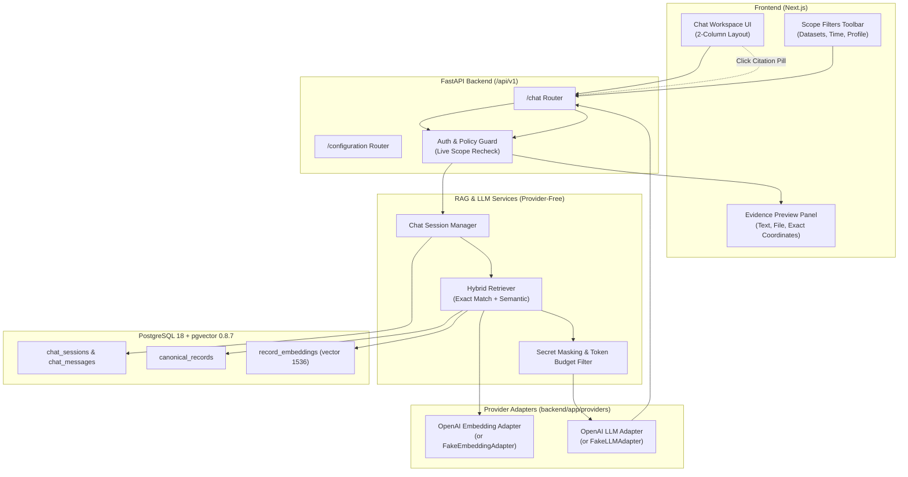

# Phase 3: Grounded Knowledge Retrieval - Research

**Researched:** 2026-10-08  
**Domain:** LangChain RAG, pgvector dense retrieval, exact lexical matching, OpenAI provider adapters, and grounded Q&A  
**Confidence:** HIGH  

<user_constraints>
## User Constraints (from CONTEXT.md)

### Locked Decisions

- **D-01 (Bố cục 2 cột):** Giao diện Hỏi - Đáp thiết kế theo bố cục 2 cột:
  - Cột bên trái: Luồng hội thoại hỏi đáp chính, bao gồm hộp nhập câu hỏi, danh sách tin nhắn của người dùng và câu trả lời của AI. Các khẳng định có trích dẫn được đánh số dạng thẻ citation `[1]`, `[2]`.
  - Cột bên phải: Panel chi tiết trích dẫn nguồn (Evidence Preview Panel). Khi người dùng bấm vào một thẻ citation, panel lập tức mở ra hiển thị: đoạn văn bản trích dẫn gốc, tên tệp nguồn (`logical_filename`), phiên bản (`v{n}`), tên dataset và tọa độ chính xác (Trang đối với PDF, Dòng đối với Log/TXT, Sheet & Hàng đối với Excel/CSV, JSON Path đối với JSON/JSONL).
- **D-02 (Lưu trữ phiên & Lịch sử hội thoại):** Lưu trữ các phiên hỏi đáp (Chat sessions / threads) theo từng tài khoản vào cơ sở dữ liệu (`chat_sessions`, `chat_messages`):
  - Người dùng có danh sách lịch sử các phiên trò chuyện ở thanh bên để mở lại các cuộc hội thoại cũ.
  - Có nút "Cuộc trò chuyện mới" để khởi tạo phiên hỏi đáp mới.
  - Ngữ cảnh trò chuyện đa lượt (multi-turn context) được duy trì trong cùng một phiên, nhưng mỗi lượt truy xuất RAG vẫn chỉ nạp các đoạn bằng chứng liên quan trong giới hạn token budget.
- **D-03 (Bộ lọc phạm vi truy xuất tùy chọn):**
  - Mặc định: Hệ thống tìm kiếm và truy xuất trên toàn bộ các dataset mà tài khoản người dùng đang được cấp quyền.
  - Bộ lọc nâng cao: Cung cấp thanh công cụ bộ lọc có thể mở rộng (Scope Filters: chọn Dataset cụ thể, chọn loại tài liệu SOP/Log/Ticket/Bảng vận hành, chọn khoảng thời gian) ở đầu khung chat để người dùng chủ động thu hẹp phạm vi khi cần tra cứu tập trung.
- **D-04 (Cảnh báo trực quan khi thiếu thông tin hoặc mâu thuẫn):**
  - Khi bằng chứng truy xuất không đủ để trả lời chắc chắn hoặc phát hiện mâu thuẫn giữa các nguồn tài liệu (RAG-05):
    - Câu trả lời tự nhiên của AI nêu rõ các điểm chưa biết, các giả thuyết chưa được xác nhận và nguyên nhân mâu thuẫn.
    - Giao diện hiển thị thêm Banner/Huy hiệu cảnh báo trực quan màu vàng ("Thiếu dữ liệu xác thực" hoặc "Phát hiện mâu thuẫn giữa các nguồn") ngay trên khối tin nhắn để kỹ thuật viên nhận diện tức thì.
- **D-05 (Kiểm tra quyền thời gian thực - Live Scope Recheck):**
  - Mang sang từ Phase 1 và Phase 2 (`recheck_response`): Khi người dùng bấm vào citation để xem chi tiết đoạn trích ở Panel bên phải hoặc khi tải lại lịch sử tin nhắn cũ, backend lập tức tái kiểm tra quyền dataset hiện tại của tài khoản.
  - Nếu quyền trên dataset của nguồn đó đã bị Admin thu hồi, nội dung đoạn trích sẽ bị chặn kèm thông báo rõ ràng "Quyền truy cập nguồn dữ liệu đã thay đổi hoặc bị thu hồi", không để lộ thông tin nguồn.
- **D-06 (Che giấu Secret & Token Budget Egress):**
  - Áp dụng bộ lọc che secret (Sample token/key masking) ở cả hai đường: trước khi gửi embedding chunk/query và trước khi gửi generation context sang OpenAI API (SYS-03).
  - Áp dụng token budget nghiêm ngặt cho generation context, không gửi toàn bộ tài liệu nguyên bản.

### the agent's Discretion

- Thiết kế cấu trúc bảng cơ sở dữ liệu cho lịch sử chat (`chat_sessions`, `chat_messages`) và quan hệ với evidence citations.
- Chọn chiến lược chunking và vector store adapter (`pgvector` + `SQLAlchemy 2.0`) tương thích phiên bản pgvector 0.8.7 và PostgreSQL 18 hiện có.
- Cơ chế Hybrid Retrieval: Kết hợp tìm kiếm chính xác (Exact Identifier Matching trên mã đơn hàng `DH001`, `ERR-502`) với tìm kiếm ngữ nghĩa dense embedding (pgvector) để đảm bảo không bị nhầm lẫn giữa các mã tương tự như `DH001` và `DH010` (RAG-02).
- Thiết kế Provider Interfaces độc lập: `EmbeddingProvider` và `LLMProvider` với Fake/Mock adapters cho test suite và OpenAI adapters cho chạy thực tế trong package `backend/app/providers/`.
- Giao diện Admin cấu hình model tại trang `/configuration`: hiển thị trạng thái model, dimension, index version và cho phép thiết lập API key/model name.

### Deferred Ideas (OUT OF SCOPE)

- Chức năng xuất toàn bộ phiên hội thoại ra PDF: Thuộc Phase 5 (On-Demand Incident Reports and PDF).
- Chức năng tự động liên kết hội thoại với Ticket / Incident cụ thể: Thuộc Phase 4 (Logistics Incident and Ticket Analysis).
- AI Agent gọi công cụ bên ngoài hoặc MCP: Dành cho giai đoạn mở rộng sau MVP.
</user_constraints>

<architectural_responsibility_map>
## Architectural Responsibility Map

| Capability | Primary Tier | Secondary Tier | Rationale |
|------------|-------------|----------------|-----------|
| Embedding Generation & Vector Storage | API/Backend (`app.providers.openai_embedding`, `app.database`) | Database (pgvector 0.8.7) | Chunk vectorization và cosine distance indexing lưu tại PostgreSQL; remote call qua OpenAI Embedding API |
| Hybrid Retrieval (Exact + Semantic) | API/Backend (`app.rag.retriever`) | Database (SQL queries) | SQL exact filtering cho `DH001` và semantic pgvector similarity kết hợp trước khi format context |
| Secret Masking Filter | API/Backend (`app.rag.sanitizer`) | — | Pure function che giấu credential, key, secret trước khi gửi egress sang bất kỳ remote AI API nào |
| Grounded LLM Response & Citations | API/Backend (`app.providers.openai_llm`) | OpenAI API | Bounded context prompt kèm citation constraints trả về câu trả lời có cấu trúc và mảng citation IDs |
| Chat Session & History Persistence | API/Backend (`app.database`, `app.api.chat`) | Database (PostgreSQL) | Lưu phiên hỏi đáp và tin nhắn bền vững theo tài khoản, hỗ trợ khôi phục ngữ cảnh |
| Live Scope Recheck on Citation Preview | API/Backend (`app.api.chat`, `app.auth.policy`) | — | Kiểm tra quyền dataset tức thời trước khi trả chi tiết đoạn trích dẫn |
| Two-column Chat & Citation Preview UI | Browser/Client (Next.js) | Frontend Server (App Router) | Khung chat trực quan, citation pills `[1]`, `[2]`, panel xem trước tọa độ và warning banner vàng |
</architectural_responsibility_map>

<research_summary>
## Summary

Phase 3 thiết lập lõi hỏi đáp tri thức có kiểm chứng (Grounded Knowledge Retrieval) bằng tiếng Việt cho hệ thống Logistics RAG. Trọng tâm của giai đoạn là xây dựng pipeline RAG tin cậy: chuyển đổi các bản ghi sạch (`canonical_records`) từ Phase 2 thành vector embeddings lưu trong PostgreSQL qua extension `pgvector 0.8.7`, triển khai cơ chế Hybrid Retrieval (kết hợp exact lexical matching và dense semantic search) để loại bỏ hoàn toàn rủi ro nhầm lẫn mã định danh (như `DH001` và `DH010`), bảo vệ dữ liệu bằng bộ lọc che giấu secret trước khi gọi API ra bên ngoài, và cung cấp giao diện tương tác 2 cột hiện đại cho phép kỹ thuật viên mở xem ngay đoạn trích dẫn gốc kèm tọa độ provenance chính xác.

Tuân thủ kiến trúc phân tầng độc lập (Clean Architecture) đã được khóa trong `backend/tests/unit/test_module_boundaries.py`, các client gọi `openai` hoặc `langchain` không được phép import trực tiếp vào các package lõi (`app.rag`, `app.llm`, `app.database`, `app.auth`). Toàn bộ client tích hợp bên thứ ba được cô lập hoàn toàn trong package `backend/app/providers/`, hiện thực hóa các Protocol contract (`EmbeddingProvider`, `LLMProvider`) và cung cấp đầy đủ `FakeEmbeddingProvider`, `FakeLLMProvider` cho bộ kiểm thử ngoại tuyến đạt tốc độ cao và không tốn chi phí API.

**Primary recommendation:** Triển khai vector table `record_embeddings` trong PostgreSQL với kiểu dữ liệu `vector(1536)` thông qua package `pgvector.sqlalchemy` (tương thích hoàn hảo với SQLAlchemy 2.0 và Psycopg 3), kết hợp truy vấn hybrid (Exact SQL ILIKE/Regex + pgvector Cosine Distance) để đáp ứng trọn vẹn yêu cầu RAG-02 và RAG-04.
</research_summary>

<standard_stack>
## Standard Stack

### Core Backend & Vector
| Library | Version | Purpose | Why Standard |
|---|---|---|---|
| `pgvector` | `0.3.6` (PyPI) | Hỗ trợ kiểu `Vector` cho SQLAlchemy 2.0 và driver Psycopg 3 | Giao tiếp trực tiếp với extension pgvector 0.8.7 trong PostgreSQL 18 mà không gây xung đột dependency |
| `openai` | `2.41.1` (Đã cài đặt) | SDK chính thức gọi OpenAI Embeddings (`text-embedding-3-small`) và Chat Completions (`gpt-4o-mini`) | Thư viện chuẩn do OpenAI duy trì, hỗ trợ typing đầy đủ và connection pooling |
| `tiktoken` | `0.13.0` (Đã cài đặt) | Đếm token chính xác cho context budget và prompt truncation | Đảm bảo không vượt quá token budget và tính toán chi phí trước khi gửi egress |
| `rank-bm25` | `0.2.2` (Đã cài đặt) | Thuật toán xếp hạng từ khóa BM25 cho lexical retrieval | Tối ưu hóa truy xuất từ khóa nhanh chóng trong bộ nhớ khi kết hợp hybrid retrieval |

### Supporting Tools
| Library | Version | Purpose | When to Use |
|---|---|---|---|
| `pydantic` | `2.13.4` (Đã cài đặt) | Validation DTOs bất biến (`extra="forbid"`, `frozen=True`) | Toàn bộ request/response boundary DTOs cho Chat, Citations và Config |
| `pytest` | `9.1.1` (Đã cài đặt) | Kiểm thử đơn vị và tích hợp | Kiểm thử mock providers, boundary contracts, hybrid retrieval và live scope recheck |

### Alternatives Considered
| Instead of | Could Use | Tradeoff |
|---|---|---|
| `pgvector.sqlalchemy` | `langchain-postgres` | `langchain-postgres` kéo theo nhiều dependency langchain không cần thiết và ràng buộc phiên bản chặt chẽ; `pgvector.sqlalchemy` nhẹ hơn, tích hợp trực tiếp vào Alembic/SQLAlchemy 2.0 |
| Hybrid SQL Regex + pgvector | External Elasticsearch/Qdrant | Qdrant/Elasticsearch bị loại bỏ khỏi MVP để giữ Docker Compose gọn nhẹ và duy trì duy nhất một nguồn chuẩn PostgreSQL |

</standard_stack>

<architecture_patterns>
## Architecture Patterns

### System Architecture Diagram



### 1. Hybrid Retrieval Pattern (RAG-02 Giải quyết DH001 vs DH010)

Mã đơn hàng, mã lỗi hoặc correlation ID (ví dụ: `DH001`, `ERR-502`) khi mã hóa thành vector thường có khoảng cách cosine rất gần với các mã tương tự (như `DH010`, `DH002`), dẫn đến việc tìm kiếm thuần vector có thể trả về nhầm bản ghi.

**Giải pháp Hybrid Retrieval:**
1. **Trích xuất Identifier:** Dùng Regex nhận diện các mẫu định danh logistics trong câu hỏi (ví dụ: `\b[A-Z]{2,4}\d{3,8}\b`, `\bERR-\d{3,5}\b`, UUID).
2. **Exact Lexical Query:** Truy vấn trực tiếp trong bảng `canonical_records` với SQL:
   ```sql
   SELECT id, dataset_id, source_id, source_version, locator, text_content
   FROM canonical_records
   WHERE dataset_id = ANY(:allowed_dataset_ids)
     AND source_version_active = true
     AND text_content ~* :pattern
   ```
3. **Dense Semantic Query:** Tạo embedding cho câu hỏi và truy vấn top-k bản ghi theo cosine similarity:
   ```sql
   SELECT r.id, r.locator, r.text_content, 1 - (e.embedding <=> :query_vec) AS similarity
   FROM record_embeddings e
   JOIN canonical_records r ON e.record_id = r.id
   WHERE r.dataset_id = ANY(:allowed_dataset_ids)
   ORDER BY e.embedding <=> :query_vec
   LIMIT :k
   ```
4. **Reciprocal Rank Fusion (RRF) & Exact Boosting:** Gộp hai tập kết quả; các bản ghi khớp chính xác mã định danh được ưu tiên điểm tuyệt đối ở đầu danh sách trước khi đưa vào context cho LLM.

### 2. Provider Abstraction Pattern (Tách biệt LLM và Embedding)

Trong `backend/app/providers/`:
- `BaseEmbeddingProvider` kế thừa Protocol `EmbeddingProvider` từ `app.rag.contracts`.
- `OpenAIEmbeddingAdapter`: Triển khai qua `openai.embeddings.create(model="text-embedding-3-small", input=chunks)`.
- `FakeEmbeddingAdapter`: Sinh vector giả lập có chiều dài cố định 1536 cho môi trường kiểm thử CI/CD, không gọi mạng.
- `BaseLLMProvider` kế thừa Protocol `LLMProvider` từ `app.llm.contracts`.
- `OpenAILLMAdapter`: Triển khai qua `openai.chat.completions.create(model="gpt-4o-mini", messages=...)`.
- `FakeLLMAdapter`: Trả về phản hồi giả định có trích dẫn `[1]` theo mẫu đã định sẵn cho test suite.

### 3. Secret Masking & Egress Guard Pattern (SYS-03)

Trước khi gửi bất kỳ văn bản nào sang OpenAI API:
- Hàm `mask_secrets(text: str) -> str` áp dụng danh sách biểu thức chính quy (Regex):
  - API keys: `r"(?:sk-[a-zA-Z0-9_-]{20,})"` -> `[MASKED_KEY]`
  - Authorization headers / Tokens: `r"(?:Bearer\s+[a-zA-Z0-9_\-\.]{20,})"` -> `Bearer [MASKED_TOKEN]`
  - Passwords: `r"(?:password\s*[:=]\s*['\"][^'\"]+['\"])"` -> `password="[MASKED_PASSWORD]"`
- Unit test kiểm tra tự động các test fixtures chứa secret giả lập để xác nhận văn bản sau khi lọc không còn chứa chuỗi nhạy cảm.

### 4. Database Schema cho Chat & Embeddings

```sql
-- Bảng lưu trữ embeddings cho canonical records
CREATE TABLE record_embeddings (
    id UUID PRIMARY KEY DEFAULT gen_random_uuid(),
    record_id UUID NOT NULL REFERENCES canonical_records(id) ON DELETE CASCADE,
    dataset_id UUID NOT NULL REFERENCES datasets(id) ON DELETE CASCADE,
    embedding vector(1536) NOT NULL,
    model_name VARCHAR(128) NOT NULL,
    index_version UUID NOT NULL,
    created_at TIMESTAMPTZ NOT NULL DEFAULT NOW()
);
CREATE INDEX idx_record_embeddings_dataset ON record_embeddings(dataset_id);
CREATE INDEX idx_record_embeddings_vector ON record_embeddings USING hnsw (embedding vector_cosine_ops);

-- Bảng lưu trữ phiên trò chuyện
CREATE TABLE chat_sessions (
    id UUID PRIMARY KEY DEFAULT gen_random_uuid(),
    account_id UUID NOT NULL REFERENCES accounts(id) ON DELETE CASCADE,
    title VARCHAR(255) NOT NULL,
    created_at TIMESTAMPTZ NOT NULL DEFAULT NOW(),
    updated_at TIMESTAMPTZ NOT NULL DEFAULT NOW()
);

-- Bảng lưu trữ tin nhắn
CREATE TABLE chat_messages (
    id UUID PRIMARY KEY DEFAULT gen_random_uuid(),
    session_id UUID NOT NULL REFERENCES chat_sessions(id) ON DELETE CASCADE,
    role VARCHAR(32) NOT NULL, -- 'user', 'assistant', 'system'
    content TEXT NOT NULL,
    citations JSONB NULL, -- Danh sách EvidenceExcerptDTO kèm SourceLocator
    uncertainty_detected BOOLEAN NOT NULL DEFAULT FALSE,
    created_at TIMESTAMPTZ NOT NULL DEFAULT NOW()
);
```

</architecture_patterns>

<validation_architecture>
## Validation Architecture

### Test Infrastructure
| Layer | Tool / Framework | Execution Command |
|---|---|---|
| Backend Unit Tests | `pytest 9.1.1` (Python 3.12) | `python -m pytest backend/tests/unit/test_rag_providers.py backend/tests/unit/test_hybrid_retriever.py -q` |
| Backend Integration Tests | `pytest 9.1.1` + Test Database | `python -m pytest backend/tests/integration/test_chat_lifecycle.py backend/tests/integration/test_retrieval_access.py -q` |
| Frontend Typecheck & Build | Next.js 16.3.8 + TypeScript | `npm run typecheck && npm run build` (trong thư mục `frontend`) |
| Frontend E2E Acceptance | Playwright 1.60.0 | `npx playwright test frontend/tests/e2e/chat-retrieval.spec.ts` |

### Phase Requirements → Test Map

| Req ID | Behavior | Test Type | Automated Command | File Exists? |
|---|---|---|---|---|
| **RAG-01** | Người dùng hỏi đáp tiếng Việt trên dữ liệu được cấp quyền và nhận câu trả lời grounded kèm trích dẫn | Integration | `python -m pytest backend/tests/integration/test_chat_lifecycle.py -q` | ❌ Wave 0 |
| **RAG-02** | Tra cứu order ID `DH001` không bị lẫn `DH010` khi kết hợp exact lexical và semantic dense search | Unit / Integration | `python -m pytest backend/tests/unit/test_hybrid_retriever.py -q` | ❌ Wave 0 |
| **RAG-03** | Giới hạn truy xuất theo dataset, loại nguồn (SOP/Log/Ticket/Bảng) và khoảng thời gian | Unit / Integration | `python -m pytest backend/tests/unit/test_hybrid_retriever.py -q` | ❌ Wave 0 |
| **RAG-04** | Nhận định có evidence citations hợp lệ; server từ chối citation ID ngoài tập evidence; bấm citation mở đúng locator | API Integration | `python -m pytest backend/tests/integration/test_retrieval_access.py -q` | ❌ Wave 0 |
| **RAG-05** | Bằng chứng thiếu hoặc mâu thuẫn hiển thị rõ phần chưa biết và bật cờ cảnh báo `uncertainty_detected = True` | Unit | `python -m pytest backend/tests/unit/test_rag_providers.py -q` | ❌ Wave 0 |
| **SYS-02** | Cấu hình OpenAI provider tách biệt; hỗ trợ Fake Provider cho test; lưu trữ model/dimension/index version | Unit | `python -m pytest backend/tests/unit/test_rag_providers.py -q` | ❌ Wave 0 |
| **SYS-03** | Context chỉ chứa dữ liệu trong quyền; secret fixtures được che trước egress ở cả đường embedding và generation | Unit | `python -m pytest backend/tests/unit/test_secret_sanitizer.py -q` | ❌ Wave 0 |
| **SYS-05** | Lỗi kết nối / timeout OpenAI API trả về mã lỗi và thông báo trạng thái rõ ràng, không hiển thị kết quả giả | Integration | `python -m pytest backend/tests/integration/test_chat_lifecycle.py -q` | ❌ Wave 0 |

### Wave 0 Gaps
- [ ] `backend/tests/unit/test_secret_sanitizer.py` — kiểm thử che giấu API keys, tokens, mật khẩu trước khi gửi egress.
- [ ] `backend/tests/unit/test_rag_providers.py` — kiểm thử provider interfaces, Fake adapters, handling timeout và thiếu bằng chứng.
- [ ] `backend/tests/unit/test_hybrid_retriever.py` — kiểm thử phân biệt `DH001` vs `DH010`, bộ lọc dataset/thời gian/profile.
- [ ] `backend/tests/integration/test_chat_lifecycle.py` — kiểm thử phiên chat, gửi câu hỏi, lưu trữ tin nhắn và cập nhật session.
- [ ] `backend/tests/integration/test_retrieval_access.py` — kiểm thử live scope recheck trên citation preview và truy cập tin nhắn cũ.
- [ ] `frontend/tests/e2e/chat-retrieval.spec.ts` — kiểm thử giao diện hỏi đáp 2 cột, click citation mở panel, warning banner màu vàng.
- [ ] Bổ sung `pgvector==0.3.6` vào `backend/pyproject.toml` và cập nhật lockfile.

</validation_architecture>

<sources>
## Sources

### Primary (Official Documentation & Local Source of Truth)
- [pgvector-python GitHub](https://github.com/pgvector/pgvector-python) — SQLAlchemy Vector integration and psycopg3 connection registration.
- [OpenAI API Reference](https://platform.openai.com/docs/api-reference) — Embeddings (`text-embedding-3-small`) & Chat Completions (`gpt-4o-mini`).
- [OWASP ASVS 5.0](https://github.com/OWASP/ASVS) — V2 Validation, V4 API Services, V8 Authorization, V14 Data Protection.
- Local project sources: `.planning/PROJECT.md`, `.planning/REQUIREMENTS.md`, `.planning/phases/03-grounded-knowledge-retrieval/03-CONTEXT.md`, `backend/app/rag/contracts.py`, `backend/app/llm/contracts.py`, `backend/tests/unit/test_module_boundaries.py`.

### Registry Versions
- `pgvector==0.3.6` (PyPI)
- `openai==2.41.1` (PyPI / local environment)
- `tiktoken==0.13.0` (PyPI / local environment)
- `rank-bm25==0.2.2` (PyPI / local environment)
</sources>

## Metadata

**Research date:** 2026-10-08  
**Valid until:** 2026-11-08  
