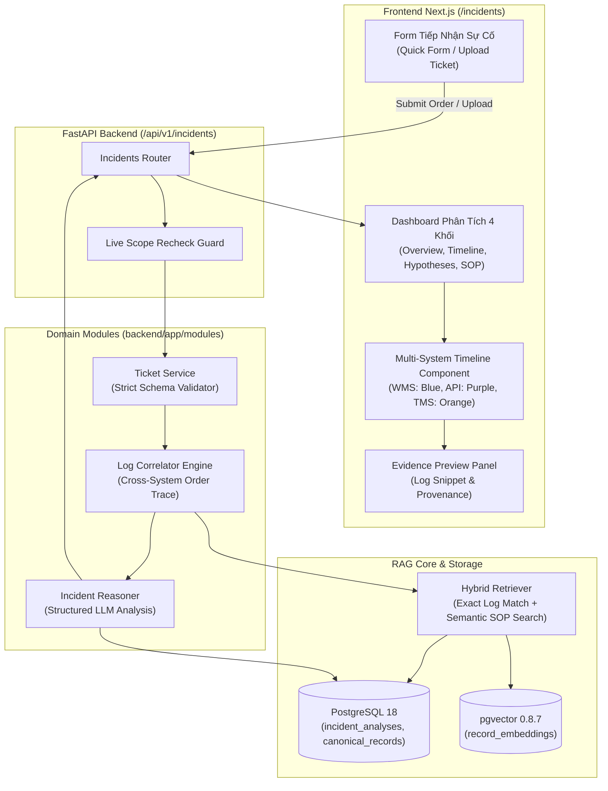

# Phase 4: Logistics Incident and Ticket Analysis - Research

**Researched:** 2026-10-14  
**Domain:** Cross-system log correlation, incident categorization, root cause hypothesis generation, SOP matching, and structured incident dashboard  
**Confidence:** HIGH  

<user_constraints>
## User Constraints (from CONTEXT.md)

### Locked Decisions

- **D-01 (Trang chuyên biệt & Phương thức nhập linh hoạt):** Cung cấp trang chuyên biệt `/incidents` trên thanh Sidebar (dành cho cả Kỹ thuật viên và Quản trị viên). Trang hỗ trợ 2 chế độ nhập dữ liệu đầu vào:
  1. *Chế độ nhập nhanh (Quick Form):* Nhập Mã đơn hàng (Order ID, ví dụ `DH001`), mô tả tóm tắt sự cố, kèm các bộ lọc tùy chọn theo hệ thống (WMS, TMS, API Gateway, hoặc Tất cả) và khoảng thời gian phát sinh.
  2. *Chế độ tải tệp Ticket (Upload Ticket File):* Cho phép tải lên tệp ticket theo định dạng JSON hoặc CSV tuân thủ schema công bố (`ticket_id`, `order_id`, `timestamp`, `system`, `severity`, `description`).
- **D-02 (Kiểm tra Schema nghiêm ngặt khi Upload):**
  - Khi người dùng tải lên tệp ticket (JSON/CSV), hệ thống kiểm tra tính hợp lệ của schema ngay lập tức.
  - Nếu tệp vi phạm cấu trúc hoặc thiếu các trường bắt buộc, hệ thống từ chối phân tích và hiển thị thông báo lỗi chi tiết đến từng số dòng và tên trường vi phạm (ví dụ: *"Dòng 3: Thiếu trường bắt buộc 'order_id'"*), ngăn ngừa dữ liệu hỏng làm sai lệch kết quả phân tích.
- **D-03 (Bố cục Dashboard chuyên sâu 4 khối):** Kết quả phân tích sự cố được trình bày trực quan và mạch lạc qua 4 khối chức năng:
  1. *Khối 1: Tóm tắt sự cố & Phân loại tự động:* Hiển thị rõ Nhóm lỗi (Lệch trạng thái, Timeout kết nối, Thiếu kiện hàng...), Hệ thống liên quan chính (WMS / TMS / API Gateway) và Mức độ ưu tiên đề xuất (P1 - Nghiêm trọng đến P4 - Thấp).
  2. *Khối 2: Trục dòng thời gian sự kiện đa hệ thống (Multi-system Event Timeline):* Liệt kê chuỗi log theo trình tự thời gian WMS -> API Gateway -> TMS liên quan đến mã đơn hàng, giúp kỹ thuật viên nắm bắt luồng dữ liệu end-to-end.
  3. *Khối 3: Giả thuyết nguyên nhân & Dữ liệu còn thiếu:* Phân biệt rành mạch giữa các *Giả thuyết nguyên nhân gốc rễ* (Root cause hypotheses) với *Nguyên nhân đã xác nhận*, đồng thời liệt kê rõ các khoảng trống thông tin/dữ liệu còn thiếu chưa đủ bằng chứng kết luận (tuân thủ RAG-05).
  4. *Khối 4: Khuyến nghị & Quy trình xử lý đề xuất:* Đưa ra các bước kiểm tra và xử lý cụ thể, có đối chiếu và trích dẫn trực tiếp từ quy trình SOP chuẩn tương ứng (ví dụ: `SOP-LOG-01`).
- **D-04 (Trục thời gian phân màu theo hệ thống & Điểm gãy đồng bộ):**
  - Mỗi sự kiện trên Trục dòng thời gian được gắn nhãn màu đặc trưng theo hệ thống (Xanh lam cho WMS, Tím cho API Gateway, Cam cho TMS).
  - Điểm phát sinh lỗi hoặc đứt gãy đồng bộ đầu tiên (sync failure point) được làm nổi bật với viền đỏ và biểu tượng cảnh báo lỗi để kỹ thuật viên nhận diện tức thì.
  - Mỗi node sự kiện cho phép nhấp vào để mở xem ngay đoạn log trích dẫn gốc kèm tọa độ provenance (file, dòng log).

### the agent's Discretion

- Thiết kế module nghiệp vụ `backend/app/modules/log_analysis` và `backend/app/modules/tickets` tách biệt, gọi qua Service layer sạch.
- Thiết kế các DTOs Pydantic v2 cho Ticket import schema, Incident Analysis Request/Response contracts.
- Lưu trữ lịch sử phân tích sự cố (`incident_analyses`) trong database liên kết với tài khoản thực hiện để tra cứu lại và phục vụ trích xuất số liệu báo cáo ở Phase 5.
- Thiết kế cơ chế đối soát liên chuỗi log (Cross-system Log Correlation) dựa trên `order_id` hoặc correlation trace id, sắp xếp theo timestamp tăng dần và không lẫn lộn giữa các mã tương tự như `DH001` và `DH010`.
- Tạo bộ fixture dữ liệu mẫu logistics hoàn chỉnh (`data/sample/logistics_incidents/`) bao gồm log WMS, log TMS, log API Gateway, danh sách ticket mẫu và SOP mẫu để phục vụ kiểm chứng `EVAL-01`.

### Deferred Ideas (OUT OF SCOPE)

- Chức năng tự động bắn webhook hoặc cập nhật trạng thái vào hệ thống WMS/TMS thật: Dành cho phiên bản mở rộng có AI Agent (EXT-04).
- Kết nối trực tiếp vào cơ sở dữ liệu live của WMS/TMS (live database connectors): Dành cho v2 (EXT-06).
- Xuất toàn bộ báo cáo phân tích sự cố ra file PDF: Thuộc Phase 5 (On-Demand Incident Reports and PDF).
</user_constraints>

<architectural_responsibility_map>
## Architectural Responsibility Map

| Capability | Primary Tier | Secondary Tier | Rationale |
|------------|-------------|----------------|-----------|
| Ticket Import & Strict Schema Validation | API/Backend (`app.modules.tickets.service`) | Browser/Client (`/incidents`) | Backend validate cấu trúc schema Pydantic/CSV DictReader theo từng dòng trước khi lưu/phân tích; UI hỗ trợ drag-and-drop và hiển thị lỗi tức thì |
| Cross-System Log Correlation Engine | API/Backend (`app.modules.log_analysis.correlator`) | Database (SQL & pgvector) | Truy vấn exact match theo `order_id` trên log WMS, API Gateway và TMS; sắp xếp timestamp theo thứ tự thời gian chuẩn ISO 8601 |
| Hybrid Incident & SOP Retrieval | API/Backend (`app.rag.retriever`) | Database (`record_embeddings`) | Kết hợp exact log retrieval cho sự cố hiện tại và semantic vector search cho tiền lệ incident/ticket cũ cùng các văn bản SOP liên quan |
| Structured Incident Reasoner & Hypotheses | API/Backend (`app.modules.log_analysis.reasoner`) | OpenAI LLM Provider | Sinh phản hồi JSON có cấu trúc nghiêm ngặt (Pydantic DTO): phân loại nhóm lỗi, hệ thống, mức ưu tiên, timeline nodes, giả thuyết nguyên nhân và các bước xử lý |
| Incident Analysis Persistence & Recheck | API/Backend (`app.modules.log_analysis.service`) | Database (`incident_analyses`) | Lưu trữ toàn bộ kết quả phân tích, timeline và snapshot citations; áp dụng Live Scope Recheck trước khi trả kết quả |
| Incident Dashboard & Event Timeline UI | Browser/Client (Next.js `/incidents`) | Frontend Server (App Router) | Dashboard 4 khối, Timeline trực quan phân màu theo hệ thống với điểm đứt gãy viền đỏ, drawer xem chi tiết trích dẫn log provenance |
</architectural_responsibility_map>

<research_summary>
## Summary

Phase 4 mang lại giá trị cốt lõi cao nhất của ứng dụng Modular RAG đối với đội ngũ kỹ thuật viên logistics: chuyển đổi từ việc hỏi đáp tài liệu đơn thuần sang phân tích chuyên sâu các sự cố vận hành IT kết hợp chuỗi cung ứng (đặc biệt là sự cố mất đồng bộ dữ liệu giữa Warehouse Management System - WMS và Transport Management System - TMS). Kỹ thuật viên đối mặt với khối lượng log khổng lồ từ nhiều hệ thống độc lập, khó xác định thời điểm và nguyên nhân gốc rễ gây tắc nghẽn đơn hàng.

Giải pháp kỹ thuật của Phase 4 giải quyết bài toán này thông qua 3 trụ cột:
1. **Engine đối soát liên chuỗi (Cross-System Log Correlator):** Sử dụng cơ chế truy xuất chính xác (Exact Identifier Lookup) từ Phase 3 để quét toàn bộ log liên quan đến mã đơn hàng (ví dụ: `DH001`) từ WMS, API Gateway và TMS; trích xuất timestamp, chuẩn hóa múi giờ (UTC/Asia/Ho_Chi_Minh), và xâu chuỗi thành dòng thời gian tuyến tính không bị đứt đoạn hay lẫn lộn với đơn hàng tương tự (`DH010`).
2. **Reasoner phân tích có cấu trúc (Structured Incident Reasoner):** Sử dụng LLM Generation Provider để phân loại nhóm lỗi (State Desync, Connection Timeout, Data Mismatch), chỉ định hệ thống phát sinh lỗi chính, đánh giá mức độ nghiêm trọng (P1-P4), và quan trọng nhất là tách bạch rõ ràng giữa *Bằng chứng thực tế của sự cố hiện tại*, *Tiền lệ tương tự trong quá khứ*, và *Quy trình chuẩn SOP đề xuất xử lý*. Khi thiếu bằng chứng, hệ thống tuyệt đối không bịa đặt nguyên nhân mà liệt kê rõ các điểm thiếu sót (Uncertainty Flagging theo RAG-05).
3. **Giao diện Dashboard 4 khối chuyên sâu:** Được thiết kế trên Next.js tại `/incidents`, cung cấp trục Timeline trực quan phân màu theo hệ thống với điểm đứt gãy đồng bộ được đóng khung cảnh báo đỏ, hỗ trợ click xem ngay dòng log gốc với tọa độ provenance chính xác.

**Primary recommendation:** Xây dựng module nghiệp vụ độc lập tại `backend/app/modules/log_analysis` và `backend/app/modules/tickets` tuân thủ Clean Architecture; sử dụng Pydantic V2 schema validation nghiêm ngặt cho tệp ticket đầu vào; lưu trữ kết quả phân tích trong bảng `incident_analyses` của PostgreSQL để sẵn sàng cho module xuất báo cáo số liệu ở Phase 5.
</research_summary>

<standard_stack>
## Standard Stack

### Core Backend & Services
| Library / Component | Version | Purpose | Why Standard |
|---|---|---|---|
| `pydantic` | `2.13.4` (Đã cài đặt) | Validation DTOs cho Ticket import schema và cấu trúc phân tích sự cố | Đảm bảo tính toàn vẹn dữ liệu, kiểm soát kiểu dữ liệu và ngăn chặn rủi ro dữ liệu rác |
| `sqlalchemy` | `2.0.44` (Đã cài đặt) | Định nghĩa bảng `incident_analyses` và thực thi truy vấn đối soát log | Tương thích hoàn toàn với PostgreSQL 18 và mô hình quan hệ hiện tại của dự án |
| `python-dateutil` | `2.9.0` (Đã cài đặt) | Phân tích cú pháp timestamp đa định dạng từ log WMS, TMS và API | Xử lý linh hoạt các định dạng thời gian khác nhau trong file log mà không làm gián đoạn timeline |
| `csv` & `json` (Built-in) | Python 3.12 | Parse tệp import ticket JSON và CSV | Thư viện chuẩn nhanh, nhẹ, không phát sinh dependency bên ngoài |

### Supporting Tools
| Library / Component | Version | Purpose | When to Use |
|---|---|---|---|
| `lucide-react` | `0.453.0` (Đã cài đặt) | Biểu tượng trực quan cho Timeline, mức ưu tiên và trạng thái hệ thống | Hiển thị icon cảnh báo, trạng thái thành công/thất bại trên Dashboard `/incidents` |
| `pytest` | `9.1.1` (Đã cài đặt) | Kiểm thử đơn vị cho Correlator, Validator, Reasoner và Live Scope Recheck | Đảm bảo bộ test chạy tự động, cô lập và tái lập được kết quả |

### Alternatives Considered
| Instead of | Could Use | Tradeoff |
|---|---|---|
| Pydantic Schema Validator | Pandas DataFrame validation | Pandas quá nặng nề cho việc validate schema ticket đơn giản; Pydantic tích hợp mượt mà với FastAPI và trả về thông báo lỗi chi tiết đến từng trường |
| Structured JSON Prompting | LangChain Agent with Tools | LangChain Agent tự hành bị cấm trong phạm vi MVP; Structured JSON Prompting qua LLM Provider kiểm soát chặt chẽ token budget, không phát sinh side-effect và ngăn ngừa hallucination |

</standard_stack>

<architecture_patterns>
## Architecture Patterns

### System Architecture Diagram



### Ticket Import Schema Specification

Hệ thống công bố schema chuẩn cho việc tải tệp Ticket:

#### JSON Schema
```json
[
  {
    "ticket_id": "TCK-2026-001",
    "order_id": "DH001",
    "timestamp": "2026-10-14T08:30:00Z",
    "system": "API_GATEWAY",
    "severity": "P1",
    "description": "Đơn hàng đóng gói xong tại Kho Sóng Thần nhưng không đồng bộ được sang TMS để điều phối xe"
  }
]
```

#### CSV Schema
```csv
ticket_id,order_id,timestamp,system,severity,description
TCK-2026-001,DH001,2026-10-14T08:30:00Z,API_GATEWAY,P1,Đơn hàng đóng gói xong tại Kho Sóng Thần nhưng không đồng bộ được sang TMS để điều phối xe
```

#### Validation Rules
1. `ticket_id`: Bắt buộc, chuỗi không rỗng (Regex: `^[A-Z0-9_-]+$`).
2. `order_id`: Bắt buộc, chuỗi định danh đơn hàng (ví dụ: `DH001`).
3. `timestamp`: Bắt buộc, định dạng chuẩn ISO 8601 (hỗ trợ `YYYY-MM-DDTHH:MM:SSZ` hoặc có offset).
4. `system`: Bắt buộc, thuộc danh mục: `WMS`, `TMS`, `API_GATEWAY`, `ERP`, `INVENTORY`, `OTHER`.
5. `severity`: Bắt buộc, thuộc danh mục: `P1`, `P2`, `P3`, `P4`.
6. `description`: Bắt buộc, chuỗi từ 5 đến 2000 ký tự.

### Cross-System Log Correlation Algorithm

1. **Thu thập Log (Exact Extraction):**
   - Truy vấn toàn bộ các đoạn log (`canonical_records`) thuộc các dataset được cấp quyền có chứa chính xác mã `order_id` (ví dụ `DH001`).
   - Loại trừ hoàn toàn các bản ghi chỉ chứa chuỗi tương tự nhưng khác biệt (như `DH010` hay `DH0011`) thông qua word-boundary / regex matching.
2. **Trích xuất & Chuẩn hóa Sự kiện (Event Normalization):**
   - Với mỗi dòng log, parser trích xuất: `timestamp`, `log_level` (`INFO`, `WARN`, `ERROR`), `system` (dựa trên metadata file hoặc tiền tố log), `event_action`, `status_code`, `message`.
   - Chuẩn hóa toàn bộ timestamp về chuẩn UTC có hỗ trợ timezone hiển thị `Asia/Ho_Chi_Minh`.
3. **Phát hiện Điểm đứt gãy đồng bộ (Sync Failure Detection):**
   - Duyệt chuỗi sự kiện theo thứ tự thời gian tăng dần.
   - Phát hiện điểm gãy đầu tiên thỏa mãn một trong các điều kiện:
     - `status_code >= 500` hoặc log level là `ERROR`/`FATAL`.
     - Khoảng cách thời gian giữa bước WMS hoàn thành đóng gói và bước TMS tiếp nhận vượt quá ngưỡng timeout quy định (ví dụ > 300 giây).
     - Trạng thái trả về từ API Gateway là `TIMEOUT`, `CONNECTION_REFUSED`, hoặc `DEAD_LETTER`.
   - Đánh dấu sự kiện này với cờ `is_failure_point = True`.

### Structured Output DTO Specification for LLM

```python
class SystemEnum(str, Enum):
    WMS = "WMS"
    TMS = "TMS"
    API_GATEWAY = "API_GATEWAY"
    ERP = "ERP"
    INVENTORY = "INVENTORY"
    UNKNOWN = "UNKNOWN"

class PriorityEnum(str, Enum):
    P1 = "P1"
    P2 = "P2"
    P3 = "P3"
    P4 = "P4"

class TimelineEventDTO(BaseModel):
    timestamp: str
    system: SystemEnum
    event_name: str
    status: str
    is_failure_point: bool
    citation_id: int
    raw_log_snippet: str

class IncidentClassificationDTO(BaseModel):
    error_group: str  # Ví dụ: "Lệch trạng thái đồng bộ (State Desync)", "Timeout kết nối API"
    primary_system: SystemEnum
    suggested_priority: PriorityEnum
    confidence: float

class RootCauseHypothesisDTO(BaseModel):
    hypothesis: str
    supporting_evidence_citations: list[int]
    is_confirmed: bool

class ActionStepDTO(BaseModel):
    step_number: int
    action: str
    sop_reference: str
    sop_citation_id: Optional[int] = None
    expected_outcome: str

class IncidentAnalysisResultDTO(BaseModel):
    order_id: str
    summary: str
    classification: IncidentClassificationDTO
    timeline: list[TimelineEventDTO]
    hypotheses: list[RootCauseHypothesisDTO]
    missing_information: list[str]
    recommended_actions: list[ActionStepDTO]
```

</architecture_patterns>

<wireframes_or_visual_flows>
## Wireframes & Visual Presentation

### Bố cục Trang `/incidents` (Desktop Layout)

```
+---------------------------------------------------------------------------------------+
| Logistics RAG  |  Dataset  |  Hỏi đáp tri thức  |  Phân tích sự cố  |  Cấu hình      |
+---------------------------------------------------------------------------------------+
|  PHÂN TÍCH SỰ CỐ ĐỒNG BỘ WMS – TMS                                                    |
|  [ Nhập nhanh Order ID ]  |  [ Tải tệp Ticket (JSON/CSV) ]                            |
|  +---------------------------------------------------------------------------------+  |
|  | Mã đơn hàng: [ DH001         ]  Hệ thống: [ Tất cả v ]  Thời gian: [ 24 giờ qua v ] |  |
|  | Mô tả ngắn:  [ Lỗi không đồng bộ vận đơn sang xe tải                          ] |  |
|  | [ Phân tích sự cố ]                                                             |  |
|  +---------------------------------------------------------------------------------+  |
|                                                                                       |
|  KẾT QUẢ PHÂN TÍCH: ĐƠN HÀNG DH001                                                    |
|  +---------------------------------------------------------------------------------+  |
|  | KHỐI 1: TỔNG QUAN & PHÂN LOẠI                                                   |  |
|  | Nhóm lỗi: Mất đồng bộ WMS-TMS (Timeout)  | Hệ thống: API Gateway | Ưu tiên: [P1]   |  |
|  | Tóm tắt: Đơn hàng đóng gói xong lúc 08:15 tại Kho Sóng Thần, nhưng API Gateway gặp  |  |
|  | lỗi 504 Timeout khi gọi sang TMS, khiến TMS không sinh được chuyến xe.             |  |
|  +---------------------------------------------------------------------------------+  |
|  | KHỐI 2: TRỤC THỜI GIAN SỰ KIỆN ĐA HỆ THỐNG (TIMELINE)                            |  |
|  |  (WMS)  08:15:00 -- [PACKED] Đóng gói hoàn tất kiện hàng 25kg             [Cit: 1]  |  |
|  |    |                                                                               |  |
|  |  [API]  08:15:05 -- [ERROR] POST /tms/v1/shipments -> 504 Gateway Timeout [Cit: 2] |  |
|  |                     *** ĐIỂM ĐỨT GÃY ĐỒNG BỘ PHÁT HIỆN TẠI ĐÂY ***  (Viền Đỏ)       |  |
|  |    |                                                                               |  |
|  |  (TMS)  08:20:00 -- [PENDING] Chưa nhận được thông tin kiện hàng           [Cit: 3]  |  |
|  +---------------------------------------------------------------------------------+  |
|  | KHỐI 3: GIẢ THUYẾT NGUYÊN NHÂN & THÔNG TIN CÒN THIẾU                             |  |
|  | [Giả thuyết 1] API Gateway bị nghẽn mạng nội bộ hoặc TMS service quá tải [Cit: 2]   |  |
|  | [Cảnh báo thiếu dữ liệu] Chưa có log chi tiết phía Database của TMS lúc 08:15:05.  |  |
|  +---------------------------------------------------------------------------------+  |
|  | KHỐI 4: KHUYẾN NGHỊ & QUY TRÌNH XỬ LÝ (SOP)                                        |  |
|  | Bước 1: Kiểm tra kết nối mạng giữa API Gateway và TMS Service (SOP-LOG-01, Mục 2)   |  |
|  | Bước 2: Thực hiện retry trigger thủ công từ WMS nếu TMS đã phục hồi (SOP-LOG-01)   |  |
|  | Bước 3: Cập nhật trạng thái phiếu hỗ trợ TCK-001 thành 'Đang xử lý'.              |  |
|  +---------------------------------------------------------------------------------+  |
+---------------------------------------------------------------------------------------+
```

</wireframes_or_visual_flows>

<eval_and_acceptance_strategy>
## Evaluation and Acceptance Strategy (EVAL-01)

Bộ dữ liệu mẫu `logistics_incidents` được thiết kế chuẩn xác để kiểm chứng toàn bộ luồng nghiệp vụ:
1. **Dữ liệu Đơn hàng `DH001` (Sự cố mất đồng bộ thực tế):**
   - File log WMS: `data/sample/wms_logs_songthan.log` (Ghi nhận mã `DH001`, trạng thái `PACKED` lúc `2026-10-14 08:15:00`).
   - File log API Gateway: `data/sample/api_gateway_access.log` (Ghi nhận request `POST /tms/v1/shipments?order_id=DH001` bị mã `504 Gateway Timeout` lúc `08:15:05`).
   - File log TMS: `data/sample/tms_dispatch.log` (Không ghi nhận mã `DH001` trong danh sách sẵn sàng điều phối).
   - Expected Output: Phân loại đúng nhóm lỗi `Mất đồng bộ WMS-TMS`, hệ thống chính `API_GATEWAY`, mức ưu tiên `P1`, chỉ ra điểm gãy tại `08:15:05` và trích dẫn quy trình `SOP-LOG-01`.
2. **Dữ liệu Đối chứng Đơn hàng `DH010` (Đơn hàng thành công):**
   - Ghi nhận đầy đủ chuỗi log: WMS Pack -> API 200 OK -> TMS Dispatch success.
   - Khi kỹ thuật viên nhập `DH010`, hệ thống phản hồi rõ ràng không phát sinh lỗi đứt gãy đồng bộ, không lẫn lộn với `DH001`.
3. **Dữ liệu Ticket mẫu:**
   - File `data/sample/sample_tickets.json` và `data/sample/sample_tickets.csv` với các ca sự cố hợp lệ và ca sự cố mẫu vi phạm schema để kiểm thử validator.
4. **Quy trình chuẩn SOP:**
   - File `data/sample/SOP-LOG-01_Xu_Ly_Loi_Dong_Bo_WMS_TMS.docx` (hoặc PDF/TXT) hướng dẫn từng bước kiểm tra mạng và retry trigger.

</eval_and_acceptance_strategy>

<## Validation Architecture>
## Validation Architecture

Nyquist validation framework áp dụng cho Phase 4 để đảm bảo chất lượng kiểm thử tự động toàn diện:

### 1. Unit Tests (`backend/tests/unit/`)
- `test_ticket_validator.py`:
  - Kiểm thử schema validation JSON và CSV: Kiểm tra trường bắt buộc, regex `ticket_id`, enum `system` và `severity`.
  - Kiểm thử phát hiện lỗi chi tiết theo dòng: Báo lỗi chính xác số dòng và tên trường vi phạm.
- `test_log_correlator.py`:
  - Kiểm thử trích xuất exact match: Định vị đúng log chứa `DH001`, không bị dính log của `DH010`.
  - Kiểm thử sắp xếp thời gian: Sắp xếp các log đa hệ thống theo thứ tự thời gian chuẩn ISO 8601.
  - Kiểm thử phát hiện điểm gãy đồng bộ: Xác định đúng sự kiện `is_failure_point` tại vị trí log lỗi 504.
- `test_incident_reasoner.py`:
  - Kiểm thử sinh phân loại và giả thuyết nguyên nhân với Mock/Fake LLM Provider.
  - Kiểm thử cờ cảnh báo thiếu dữ liệu khi thiếu log TMS.

### 2. Integration & Policy Tests (`backend/tests/integration/`)
- `test_incident_api.py`:
  - Endpoint `POST /api/v1/incidents/analyze`: Kiểm thử phân tích theo Order ID thành công.
  - Endpoint `POST /api/v1/incidents/upload-ticket`: Kiểm thử tải file ticket hợp lệ và từ chối file sai schema (HTTP 422 với chi tiết lỗi dòng).
  - Endpoint `GET /api/v1/incidents/history`: Kiểm thử lưu và truy xuất lịch sử phân tích.
- `test_incident_scope_recheck.py`:
  - Kiểm thử Live Scope Recheck: Khi thu hồi quyền truy cập dataset chứa log của `DH001`, kỹ thuật viên gọi API xem lại kết quả phân tích hoặc click xem citation phải nhận mã HTTP 403 Forbidden.

### 3. Acceptance Verification (EVAL-01)
- Chạy kịch bản E2E kiểm chứng ca sự cố `DH001` từ đầu vào form đến hiển thị Timeline 4 khối trên giao diện web.

</architecture_patterns>
