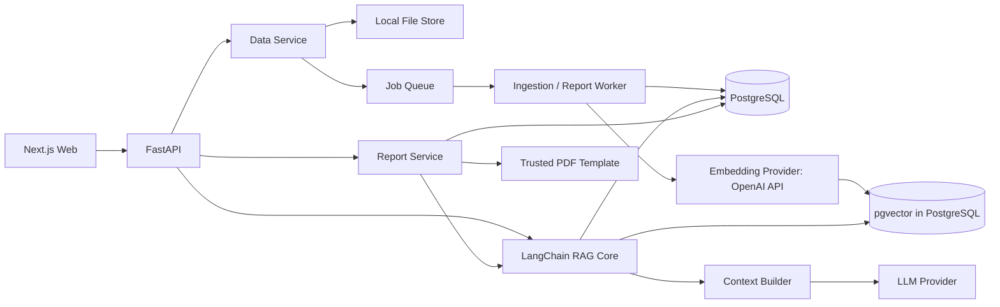

# Architecture Research

**Researched:** 2026-10-03
**Confidence:** MEDIUM — thiết kế đề xuất, chưa triển khai/benchmark.

## System Overview

## Component Responsibilities

| Module | Sở hữu |
|---|---|
| Web | Next.js/TypeScript; data manager, hỏi đáp, phân tích, báo cáo, evidence panel, tiến độ job |
| API | Validation, session nếu có, versioned contracts, pagination và error handling |
| Data Service/Worker | File/version lifecycle, parse/normalize, idempotent indexing, recovery |
| PostgreSQL | Canonical records, chunks/provenance, analyses, jobs, report snapshots |
| pgvector | Derived embedding index trong PostgreSQL; có thể dựng lại từ dữ liệu chuẩn |
| RAG Core | LangChain pipeline; entity extraction, exact/lexical/dense retrieval, fusion, evidence selection |
| Context Builder | Evidence IDs, token budget, redaction và data-only context |
| LLM Provider | Generation interface, timeout/retry bounded, usage và structured result |
| Report Service | Aggregation xác định, scope/time rules, evidence narrative, PDF snapshot |

Modular monolith với worker riêng là baseline đề xuất. Chưa cần microservices, orchestrator Agent hoặc MCP server.

## Data Contracts

- Source: source_id, version_id, checksum, type, filename, state, imported_at, parser_version.
- Chunk: chunk_id, version_id, text, section/page hoặc sheet/row hoặc log line/event locators, system/entity/time metadata.
- Event: event_id, occurred_at, timezone origin, system, severity, order_id, correlation_id, error_code, raw locator.
- Ticket/Incident: canonical ID, external ID nếu có, status, priority, systems, opened_at/resolved_at, confirmed cause nếu có, evidence links. Liên kết ticket–incident riêng; không cộng chúng thành một tổng nếu là cùng sự cố.
- Analysis: observations, hypotheses có evidence_ids, missing information, verification steps, recommendations. Không coi điểm similarity là xác suất nguyên nhân.
- Report: period [start,end), timezone, dataset snapshot/version set, counting rules, metrics, source record IDs, narrative và generated_at.

## Data Flows

### Ingestion

Upload → quyền Admin + validation → local file + source version → persisted job → parser → canonical records/chunks/locators → che secret → OpenAI Embeddings → pgvector upsert → ready. Worker retry không sinh bản ghi trùng; chỉ ready khi bước bắt buộc thành công. Query embedding cũng qua provider API.

Canonical records và vectors trong cùng PostgreSQL có thể transaction khi adapter dùng cùng connection/session; không giả định mặc định LangChain upsert chia sẻ transaction. File storage, remote embedding và jobs vẫn cần state/idempotency/recovery. Activate version sau hoàn tất; queries áp dụng dataset ACL và active-state filter. Nguồn đã xóa không còn truy xuất trước khi cleanup file/index.

### DH001 Analysis

Ticket → xác định DH001 + hệ thống/kỳ thời gian → exact events và timeline → lexical/semantic SOP và incident tương tự → fusion/dedup → bounded context → LLM structured output → kiểm tra citation IDs → UI evidence panel.

Khi không có đủ dữ liệu, trả rõ phần thiếu; khi SOP và log mâu thuẫn, trình bày cả hai thay vì ép kết luận.

### Reporting

Kỳ + bộ lọc → truy vấn canonical records theo quy tắc đếm → snapshot metrics/provenance → RAG chọn bằng chứng giải thích nhóm lỗi → LLM narrative → server chèn metrics cố định → preview → PDF.

Không cấp LLM quyền chạy SQL tùy ý. Nếu provider lỗi, báo cáo số liệu vẫn có thể hiển thị với trạng thái nhận xét chưa tạo, tránh che lỗi bằng nội dung bịa.

## Suggested Structure

Theo cấu trúc người dùng: `backend/app/{api,rag,llm,database,auth}/`, `backend/app/modules/{log_analysis,tickets,reports}/`, `backend/tests/`, `backend/scripts/`, `frontend/`, `data/{sample,uploads}/`, `storage/`, `docs/`, `docker-compose.yml`. Worker dùng backend image/entrypoint; eval fixtures dưới data/sample và tests/scripts.

API routes chỉ gọi application services. MCP/Agent về sau dùng cùng service/API contracts; không bỏ qua access controls khi thêm adapter.

Embedding Provider trong rag/ độc lập LLM Provider trong llm/. Loader/parser adapters trả nội dung + provenance; các module nghiệp vụ dùng RAG service contract, không nhận raw provider SDK. Auth enforce dataset scope trước retrieval và recheck trước trả kết quả; lịch sử/PDF cũng kiểm tra quyền hiện tại. Khi quyền bị thu hồi giữa request, response không được trả dữ liệu đã mất quyền.

## Build Order Implications

1. Local foundation + một vertical slice upload → hỏi đáp có nguồn.
2. Multi-format ingestion và lifecycle đáng tin cậy.
3. Exact/hybrid retrieval và bộ đánh giá.
4. Phân tích ticket/sự cố DH001 end-to-end.
5. Báo cáo có số liệu kiểm chứng và PDF.
6. Hardening/eval/recovery và đóng gói MVP.

Đây là gợi ý, roadmap chính thức sẽ được tạo sau scope requirements. Bottleneck cần đo trước tiên là parse/embedding CPU/RAM và thời gian index; tiếp theo là truy vấn và context/LLM latency. Không suy ra capacity từ số người dùng chưa được cung cấp.

## Sources

- [LangChain pgvector](https://docs.langchain.com/oss/python/integrations/vectorstores/pgvector), [pgvector](https://github.com/pgvector/pgvector), [Next.js](https://nextjs.org/docs/app/getting-started/installation), [OpenAI embeddings](https://developers.openai.com/api/docs/guides/embeddings): stack hiện tại.
- Qdrant là phương án nghiên cứu ban đầu, không áp dụng triển khai MVP.
- [Qdrant hybrid queries](https://qdrant.tech/documentation/search/hybrid-queries/): hỗ trợ kết hợp retrieval; cách phối hợp PostgreSQL là thiết kế dự án.
- [FastAPI background tasks](https://fastapi.tiangolo.com/tutorial/background-tasks/), [Celery](https://docs.celeryq.dev/en/stable/getting-started/introduction.html): cơ sở tách công việc xử lý nặng.
- [PostgreSQL](https://www.postgresql.org/docs/current/functions-aggregate.html): aggregation.
- [Ollama API](https://docs.ollama.com/api/introduction): ứng viên provider local.
